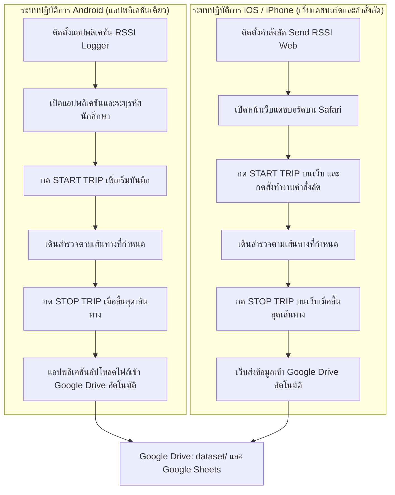
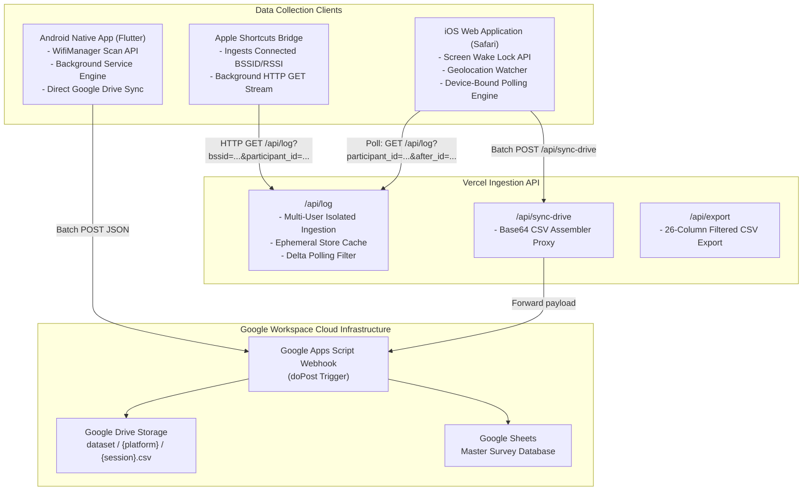

# โครงการพัฒนาระบบรวบรวมข้อมูลสัญญาณ Wi-Fi และพิกัดตำแหน่งสำหรับงานวิจัยการระบุตำแหน่งภายในอาคาร
# (Wi-Fi and GPS Telemetry Pipeline for Indoor Localization Research)

[](https://rssi-web-logger.vercel.app)
[](https://nodejs.org)
[](https://github.com/Kitsada4435/wifi-telemetry-pipeline)
[](#)

ระบบรวบรวมข้อมูลโทรมาตร (Telemetry Pipeline) สำหรับงานวิจัยด้านโครงข่ายไร้สายและการระบุตำแหน่งภายในอาคาร (Indoor Localization) รองรับการบันทึกค่าความแรงสัญญาณ Wi-Fi RSSI ควบคู่กับพิกัดดาวเทียม GPS และโหมดการเคลื่อนไหว โดยแบ่งการทำงานตามข้อกำหนดของระบบปฏิบัติการออกเป็น 2 ระบบ: แอปพลิเคชันบน Android และเว็บแดชบอร์ดร่วมกับคำสั่งลัดบน iOS

---

### เอกสารคู่มือ / Documentation
* [คู่มือการปฏิบัติงานภาษาไทย (Thai Operational Guide)](#คู่มือการปฏิบัติงานภาษาไทย)
* [Technical and Developer Guide (English)](#technical-and-developer-guide-english)

---

<a name="คู่มือการปฏิบัติงานภาษาไทย"></a>
# คู่มือการปฏิบัติงานภาษาไทย

เอกสารฉบับนี้จัดทำขึ้นเพื่อเป็นแนวทางปฏิบัติสำหรับผู้เข้าร่วมการทดลองเก็บข้อมูลภาคสนาม และนักวิจัยผู้พัฒนาระบบ

---

## สารบัญ
1. [สถาปัตยกรรมและการแบ่งส่วนการทำงาน](#1-สถาปัตยกรรมและการแบ่งส่วนการทำงาน)
2. [ขั้นตอนการติดตั้งและการเก็บข้อมูลภาคสนาม](#2-ขั้นตอนการติดตั้งและการเก็บข้อมูลภาคสนาม)
   * [2.1 ขั้นตอนสำหรับอุปกรณ์ Android (ใช้งานผ่านแอปพลิเคชัน)](#21-ขั้นตอนสำหรับอุปกรณ์-android)
   * [2.2 ขั้นตอนสำหรับอุปกรณ์ iOS / iPhone (ใช้งานผ่าน Safari และคำสั่งลัด)](#22-ขั้นตอนสำหรับอุปกรณ์-ios--iphone)
3. [ข้อกำหนดโครงสร้างข้อมูล 18 คอลัมน์มาตรฐานวิจัย (Clean 18-Column Unified Research Schema)](#3-ข้อกำหนดโครงสร้างข้อมูล-18-คอลัมน์มาตรฐานวิจัย)
4. [โครงสร้างการจัดเก็บข้อมูลบน Google Drive](#4-โครงสร้างการจัดเก็บข้อมูลบน-google-drive)

---

## 1. สถาปัตยกรรมและการแบ่งส่วนการทำงาน

เนื่องจากระบบความปลอดภัยของเบราว์เซอร์สากล (W3C Security Sandbox) ไม่อนุญาตให้หน้าเว็บเข้าถึงการสแกนฮาร์ดแวร์ Wi-Fi ได้โดยตรง โครงการจึงออกแบบระบบให้รองรับการเก็บข้อมูลตามคุณลักษณะของแต่ละแพลตฟอร์ม:



---

## 2. ขั้นตอนการติดตั้งและการเก็บข้อมูลภาคสนาม

<a name="21-ขั้นตอนสำหรับอุปกรณ์-android"></a>
### 2.1 ขั้นตอนสำหรับอุปกรณ์ Android (ใช้งานผ่านแอปพลิเคชันเดี่ยว)

ผู้ใช้อุปกรณ์ Android ดำเนินการผ่านแอปพลิเคชันเดี่ยวโดยตรง ไม่ต้องเปิดเว็บเบราว์เซอร์

#### ลิงก์ดาวน์โหลด
* **ดาวน์โหลดไฟล์ติดตั้ง:** [rssi-logger-android.apk](https://rssi-web-logger.vercel.app/downloads/rssi-logger-android.apk) (ไฟล์สำรองในระบบ: [`public/downloads/rssi-logger-android.apk`](public/downloads/rssi-logger-android.apk))

#### การติดตั้งและกำหนดสิทธิ์ (ดำเนินการครั้งแรกเพียงครั้งเดียว)
1. ดาวน์โหลดไฟล์ `rssi-logger-android.apk` ตามลิงก์ด้านบน และดำเนินการติดตั้งลงบนโทรศัพท์
2. เข้าไปที่ **การตั้งค่า (Settings)** ของโทรศัพท์ > **แอปพลิเคชัน (Apps)** > **RSSI Logger** > **สิทธิ์ (Permissions)**:
   * **ตำแหน่งที่ตั้ง (Location):** กำหนดเป็น **อนุญาตตลอดเวลา (Allow all the time)**
   * **อุปกรณ์ใกล้เคียง (Nearby devices):** กำหนดเป็น **อนุญาต (Allow)**

#### การเก็บข้อมูลภาคสนามจริง
1. เลื่อนแถบการแจ้งเตือนด้านบนของโทรศัพท์ลงมา และเปิดการทำงานของ **ตำแหน่ง (Location / GPS)**
2. เปิดแอปพลิเคชัน **RSSI Logger** (เมื่อเปิดใช้งานครั้งแรก ระบบจะแสดงหน้าต่างให้กรอก **UserID / รหัสนักศึกษา** และบันทึกถาวรไว้ในเครื่องทันที)
3. กำหนดข้อมูลการสำรวจ:
   * **UserID (รหัสนักศึกษา):** กรอกรหัสนักศึกษา (เช่น `680631034`) โดยช่องจะแสดง **กรอบสีแดง** หากยังไม่ระบุ และเปลี่ยนเป็น **กรอบสีเขียว** เมื่อกรอกรหัสถูกต้อง
   * **Mode:** เลือกโหมดการเคลื่อนที่ (walk, bike, motorcycle, car)
   * **Position:** เลือกลักษณะการพกพาโทรศัพท์ (pocket, hand, bag)
4. กดปุ่ม **START TRIP**
5. เดินเก็บข้อมูลตามเส้นทางที่กำหนด
6. เมื่อสิ้นสุดเส้นทาง กดปุ่ม **STOP TRIP**
7. ระบบจะบันทึกข้อมูลและอัปโหลดไฟล์ CSV เข้าสู่ Google Drive ของโครงการโดยอัตโนมัติ

---

<a name="22-ขั้นตอนสำหรับอุปกรณ์-ios--iphone"></a>
### 2.2 ขั้นตอนสำหรับอุปกรณ์ iOS / iPhone (ใช้งานผ่าน Safari และคำสั่งลัด)

ผู้ใช้อุปกรณ์ iPhone (iOS 17+) ดำเนินการผ่านหน้าเว็บ Safari ร่วมกับคำสั่งลัดระบบ โดยระบบแดชบอร์ดมีระบบคำนวณความเร็วการเคลื่อนที่แบบ Kinematic (Haversine $\Delta d / \Delta t$) เพื่อบันทึกความเร็วในการเดินจริงได้อย่างแม่นยำแม้ Safari จะส่งค่าความเร็วเป็น 0

#### ลิงก์ดาวน์โหลดและหน้าเว็บแดชบอร์ด
* **หน้าเว็บแดชบอร์ดหลัก:** [https://rssi-web-logger.vercel.app](https://rssi-web-logger.vercel.app)
* **ดาวน์โหลดคำสั่งลัด:** [Send Rssi Logger Web.shortcut](https://rssi-web-logger.vercel.app/downloads/Send%20Rssi%20Logger%20web.shortcut) (ไฟล์สำรองในระบบ: [`public/downloads/Send Rssi Logger web.shortcut`](public/downloads/Send%20Rssi%20Logger%20web.shortcut))

#### การติดตั้งและกำหนดสิทธิ์ (ดำเนินการครั้งแรกเพียงครั้งเดียว)
1. เข้าไปที่ **การตั้งค่า (Settings)** บน iPhone > **ความเป็นส่วนตัวและความปลอดภัย (Privacy & Security)** > **บริการหาตำแหน่งที่ตั้ง (Location Services)** > เลื่อนหาแอป **คำสั่งลัด (Shortcuts)** > กำหนดเป็น **ในระหว่างใช้แอป (While Using the App)**
2. ดาวน์โหลดไฟล์คำสั่งลัดจากลิงก์ด้านบน จากนั้นเปิดแอป **ไฟล์ (Files)** > แตะค้างที่ไฟล์ > เลือก **แชร์ (Share)** > เลือก **คำสั่งลัด (Shortcuts)** เพื่อเพิ่มลงในระบบ

#### การเก็บข้อมูลภาคสนามจริง
1. เปิดหน้าเว็บ [https://rssi-web-logger.vercel.app](https://rssi-web-logger.vercel.app) ผ่านเบราว์เซอร์ Safari (เมื่อเปิดเว็บครั้งแรก ระบบจะแสดงหน้าต่างให้กรอก **UserID / รหัสนักศึกษา** และจำไว้ตลอดไป)
2. กำหนดข้อมูลการสำรวจ:
   * **UserID (รหัสนักศึกษา):** ตรวจสอบรหัสนักศึกษา (ช่องจะมี **กรอบสีเขียว** เมื่อระบุรหัสเรียบร้อยแล้ว หรือสีแดงหากยังไม่ระบุ)
   * **โหมดการเดินทาง:** แตะเลือกโหมด (เดิน, จักรยาน, มอเตอร์ไซค์, รถยนต์)
   * **ตำแหน่งพกพา:** แตะเลือกตำแหน่ง (กางเกง, ในมือ, กระเป๋า)
3. กดปุ่ม **เริ่มบันทึก (START TRIP)** บนหน้าเว็บ
4. สลับไปกดปุ่ม **Play** ในแอปคำสั่งลัด (หรือสั่งทำงานผ่านวิดเจ็ตหน้าจอโฮม)
5. สลับกลับมาที่หน้าเว็บ ตรวจสอบการอัปเดตของค่าสัญญาณ Wi-Fi และพิกัด GPS
6. เดินสำรวจตามเส้นทางที่กำหนด
7. เมื่อสิ้นสุดเส้นทาง กดปุ่ม **หยุดบันทึก (STOP TRIP)** บนหน้าเว็บ
8. ระบบจะส่งข้อมูลทั้งหมดขึ้นสู่ Google Drive ของโครงการโดยอัตโนมัติ

---

## 3. ข้อกำหนดโครงสร้างข้อมูล 18 คอลัมน์มาตรฐานวิจัย (Clean 18-Column Unified Research Schema)

ชุดข้อมูลโทรมาตรทั้งหมดจากทั้ง Android Application และ iOS Web Pipeline จัดเก็บในโครงสร้างตาราง 18 คอลัมน์มาตรฐานเดียวกัน โดยทุกอุปกรณ์บันทึกข้อมูลได้เต็ม 100% ทุกคอลัมน์ (Zero Missing Values) ทำให้สามารถรวมไฟล์ชุดข้อมูล (Data Concatenation) สำหรับฝึกสอนแบบจำลองปัญญาประดิษฐ์ (AI/ML Model Training) ได้อย่างสมบูรณ์:

| ลำดับ | ชื่อคอลัมน์ (Column Name) | ชนิดข้อมูล (Data Type) | ตัวอย่างข้อมูล | คำอธิบายรายละเอียด |
| :---: | :--- | :---: | :--- | :--- |
| 1 | `t_utc_ms` | Integer (Epoch ms) | `1793766101811` | ค่าเวลา Unix Epoch ในหน่วยมิลลิวินาที สำหรับเทียบเวลาอ้างอิงสากล |
| 2 | `timestamp` | ISO 8601 String | `2026-11-04T11:21:41.811Z` | วันและเวลามาตรฐานสากล (UTC) |
| 3 | `session_id` | String | `TRIP-20261104-A9F2` | รหัสรอบการเก็บข้อมูลประจำการสำรวจ |
| 4 | `participant_id` | String | `680631034` | รหัสนักศึกษาผู้ร่วมการสำรวจ หรือรหัสอ้างอิงฮาร์ดแวร์ |
| 5 | `platform` | String | `android`, `ios` | ระบบปฏิบัติการของอุปกรณ์ที่ใช้เก็บข้อมูล |
| 6 | `device_model` | String | `samsung SM-S948B`, `iPhone` | ข้อมูลรุ่นฮาร์ดแวร์ของอุปกรณ์ |
| 7 | `os_version` | String | `Android 14`, `iOS 18.1` | เวอร์ชันของระบบปฏิบัติการ |
| 8 | `lat` | Float | `18.7954698` | ละติจูดพิกัดดาวเทียม GPS |
| 9 | `lon` | Float | `98.9528959` | ลองจิจูดพิกัดดาวเทียม GPS |
| 10 | `speed` | Float (ทศนิยมละเอียด) | `0.45`, `1.20` | ความเร็วในการเคลื่อนที่ (km/h) บันทึกทศนิยมเพื่อรองรับการเดินความเร็วต่ำ |
| 11 | `accuracy` | Float (เมตร) | `5.0` | รัศมีความคลาดเคลื่อนในแนวราบของ GPS |
| 12 | `bssid` | String | `04:5f:b9:e4:f1:4a` | ที่อยู่ทางกายภาพ (MAC Address) ของอุปกรณ์กระจายสัญญาณ Wi-Fi |
| 13 | `ssid` | String | `@JumboPlus5GHz` | ชื่อเครือข่ายสัญญาณ Wi-Fi ที่เชื่อมต่อ |
| 14 | `rssi_raw` | Float (dBm) | `-45.0` | ค่าความแรงสัญญาณดิบ (Received Signal Strength Indicator) |
| 15 | `rssi_source` | String | `wifimanager`, `shortcut` | ช่องทางที่ระบบดึงข้อมูลค่าสัญญาณ Wi-Fi |
| 16 | `user_label_mode` | String | `walk`, `bike`, `motorcycle`, `car` | โหมดการเคลื่อนที่ที่ผู้สำรวจเลือกกำหนด (Ground Truth Label) |
| 17 | `phone_position` | String | `pocket`, `hand`, `bag` | ลักษณะการพกพาอุปกรณ์โทรศัพท์ขณะสำรวจ |
| 18 | `note` | String | `อาคารวิศวะ ชั้น 3, โซนแล็บ` | บันทึกรายละเอียดบริบทสถานที่หรือจุดสังเกตเพิ่มเติม |

---

## 4. โครงสร้างการจัดเก็บข้อมูลบน Google Drive

ข้อมูลที่ส่งขึ้นจากอุปกรณ์จะถูกจำแนกเข้าสู่โฟลเดอร์โครงการตามแพลตฟอร์ม:
* **พาธหลักบน Google Drive:** `ไดรฟ์ของฉัน > RSSI_Database > dataset`
* `dataset/android/` — สำหรับจัดเก็บไฟล์ CSV ที่ส่งมาจากแอปพลิเคชัน Android
* `dataset/ios/` — สำหรับจัดเก็บไฟล์ CSV ที่ส่งมาจากระบบเว็บ Safari บน iPhone
* **Google Sheet บันทึกส่วนกลาง:** จัดเก็บข้อมูลแบบแถวเรียงตามเวลา พร้อมระบุรหัสผู้สำรวจเพื่อใช้ในการวิเคราะห์ขั้นต้น

---

<br><br>

---

<a name="technical-and-developer-guide-english"></a>
# Technical and Developer Guide (English)

Technical specification and developer documentation for engineers extending or deploying the **Wi-Fi and GPS Telemetry Pipeline**.

---

## Architecture Specification



---

## Monorepo Directory Layout

```text
wifi-telemetry-pipeline/
├── README.md                            # Comprehensive Bilingual Technical Documentation
├── package.json                         # Node.js dependencies and project metadata
├── server.js                            # Local development Express server
├── vercel.json                          # Vercel Serverless rewrite configurations
├── api/                                 # Vercel Serverless Functions (Web Backend)
│   ├── log.js                           # Telemetry ingestion and isolated delta polling
│   ├── sync-drive.js                    # Batch Google Drive / Sheets sync proxy
│   ├── logs.js                          # Backward-compatibility alias
│   └── export.js                        # Isolated 26-column CSV export stream
├── public/                              # Web Dashboard Frontend (iOS / Desktop)
│   ├── index.html                       # Minimalist high-contrast user interface
│   ├── style.css                        # Mobile-optimized dark mode CSS
│   ├── app.js                           # State controller, GPS watcher, delta polling
│   └── downloads/                       # Client installation and distribution bundles
│       ├── Send Rssi Logger web.shortcut # Apple Shortcut template
│       ├── rssi-logger-android.apk      # Standalone Android Application APK
│       └── macrodroid_guide.txt         # Alternative Android automation guide
├── mobile_app/                          # Android Application Source Code (Flutter)
│   ├── android/                         # Native Android Gradle configuration
│   ├── lib/                             # Dart application source code
│   │   ├── main.dart                    # Application UI entry point
│   │   ├── sensor_manager.dart          # Wi-Fi BSSID/RSSI, GPS, and motion manager
│   │   ├── cloud_manager.dart           # Direct Google Apps Script upload engine
│   │   └── export_manager.dart          # Local SQLite and CSV export engine
│   └── pubspec.yaml                     # Flutter package dependencies
├── docs/                                # Academic Papers, Research Proposals & Specs
│   ├── Phase_0_Research_Proposal_And_Specs.md
│   ├── Phase_1_App_Development_And_Pipeline.md
│   ├── Phase_2_Data_Collection_And_ML_Pipeline.md
│   ├── RESEARCH_TITLES_AND_CONCEPTS.md
│   └── 4Inferring_Trips_and_Origin-Destination_Flows_...pdf
├── dataset/                             # Sample Test Datasets (CSV)
└── scripts/
    ├── google_drive_script.js           # Production Google Apps Script webhook code
    └── test_ping.py                     # CLI telemetry ingestion simulation script
```

---

## API Specification

### 1. Ingest and Poll Telemetry: `/api/log`
Handles incoming telemetry data from mobile clients and delivers isolated streams to matching web clients.

* **Method:** `GET` | `POST`
* **Query Parameters (Ingestion):**
  * `bssid` (string): Physical MAC Address of the Access Point.
  * `ssid` (string): Connected Wi-Fi network SSID.
  * `rssi` / `rssi_raw` (number): Received signal strength indicator in dBm.
  * `participant_id` (string, required): Student ID or persistent hardware identifier.
  * `session_id` / `trip_id` (string, optional): Current survey session identifier.
  * `lat` / `latitude` (float, optional): Latitude coordinate.
  * `lon` / `longitude` (float, optional): Longitude coordinate.
  * `speed` (float, optional): Moving speed.
  * `accuracy` (float, optional): Horizontal accuracy in meters.
  * `user_label_mode` (string, optional): Ground-truth mode (`walk`, `bike`, `motorcycle`, `car`).
  * `activity_recognition_mode` (string, optional): Motion recognition mode (`still`, `walk`, `run`, `vehicle`).
  * `phone_position` (string, optional): Carrying position (`pocket`, `hand`, `bag`).
  * `note` (string, optional): Contextual location description.
* **Query Parameters (Multi-User Dashboard Polling):**
  * `action=get`: Required query to poll telemetry.
  * `participant_id` (string, required): Returns records matching this participant ID only.
  * `after_id` (integer, optional): Returns records with `id > after_id` for efficient delta polling.
* **Query Parameters (Data Reset):**
  * `action=clear&participant_id=...` or `DELETE`: Clears in-memory storage for that specific participant only.

#### Sample Ingestion Request:
```http
GET /api/log?bssid=04:5F:B9:E4:F1:4A&ssid=@JumboPlus5GHz&rssi=-45&participant_id=680631034&user_label_mode=walk&phone_position=pocket HTTP/1.1
Host: rssi-web-logger.vercel.app
```

#### Sample Polling Request:
```http
GET /api/log?action=get&participant_id=680631034&after_id=42 HTTP/1.1
Host: rssi-web-logger.vercel.app
```

---

### 2. Batch Cloud Synchronization: `/api/sync-drive`
Proxies survey batch datasets to Google Apps Script.

* **Method:** `POST`
* **Headers:** `Content-Type: application/json`
* **Body:**
```json
{
  "webhook_url": "https://script.google.com/macros/s/.../exec",
  "trip_id": "TRIP-20261104-A9F2",
  "participant_id": "680631034",
  "logs": [ ...array of 26-column telemetry entries... ]
}
```

---

## Local Development and Deployment

### 1. Running the Web Pipeline Locally
```bash
# Install dependencies
npm install

# Start development server
npm start

# Access local dashboard
http://localhost:3000
```

### 2. Building the Android Mobile Application
```bash
cd mobile_app
flutter pub get
flutter build apk --release
# Output binary: mobile_app/build/app/outputs/flutter-apk/app-release.apk
```

### 3. Vercel Production Deployment
Each commit pushed to the `main` branch triggers an automated build and deployment on Vercel. Serverless rewrite rules in `vercel.json` handle API routing.

---

## License

* **Project:** Wi-Fi and GPS Telemetry Pipeline for Indoor Localization Research
* **License:** [MIT License](LICENSE)
