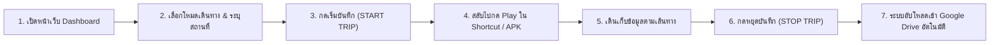
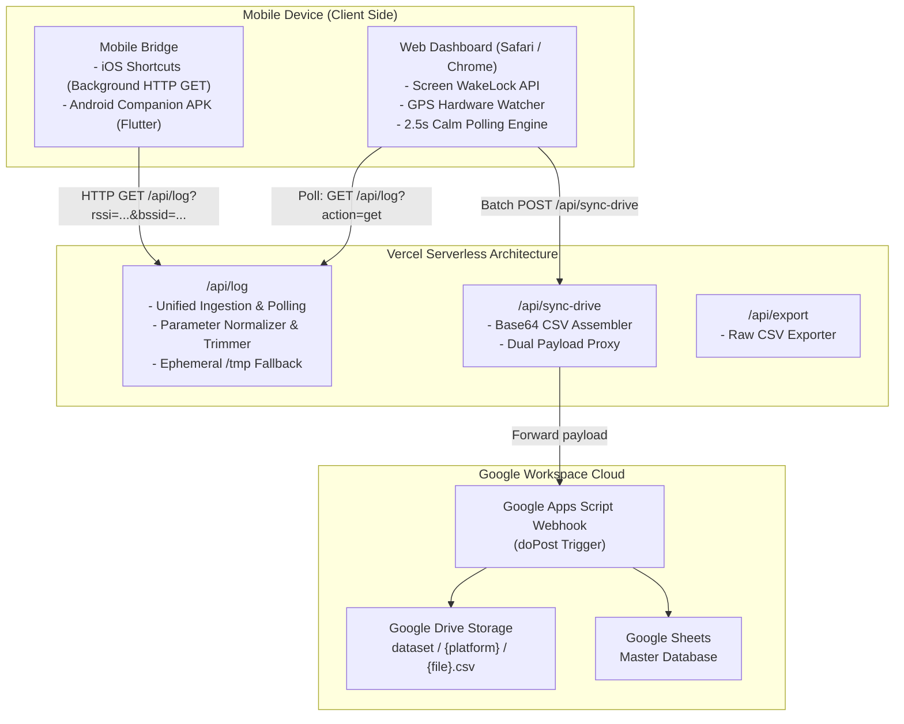

# RSSI Web Logger: Wi-Fi and GPS Telemetry Pipeline

[](https://rssi-web-logger.vercel.app)
[](https://nodejs.org)
[](https://github.com/Kitsada4435/rssi-web-logger)
[-success?style=flat)](#)

Web Application and Telemetry Bridge pipeline designed for field data collection and academic research. Collects synchronized Wi-Fi RSSI (dBm), MAC/BSSID, SSID, and GPS metrics directly on iOS (iOS 17+) and Android, deployed on Vercel with automated cloud synchronization to Google Drive and Google Sheets.

---

### Language / ภาษา
* [คู่มือภาษาไทย (Thai Guide)](#คู่มือภาษาไทย-thai-guide)
* [Developer and Technical Guide (English)](#developer-and-technical-guide-english)

---

<a name="คู่มือภาษาไทย-thai-guide"></a>
# คู่มือภาษาไทย (Thai Guide)

เอกสารฉบับนี้จัดทำขึ้นสำหรับนักศึกษาที่เข้าร่วมการทดลองเก็บข้อมูลภาคสนาม และนักพัฒนาที่ดูแลระบบต่อยอด

---

## สารบัญ
1. [วัตถุประสงค์และการทำงานของระบบ](#1-วัตถุประสงค์และการทำงานของระบบ)
2. [คู่มือสำหรับนักศึกษา: การติดตั้งและใช้งานบนมือถือ](#2-คู่มือสำหรับนักศึกษา-การติดตั้งและใช้งานบนมือถือ)
   * [สำหรับ iPhone / iPad (iOS 17+)](#สำหรับ-iphone--ipad-ios-17)
   * [สำหรับสมาร์ตโฟน Android](#สำหรับสมาร์ตโฟน-android)
3. [ขั้นตอนการเก็บข้อมูลภาคสนามจริง](#3-ขั้นตอนการเก็บข้อมูลภาคสนามจริง)
4. [การจัดระเบียบข้อมูลบน Google Drive](#4-การจัดระเบียบข้อมูลบน-google-drive)
5. [โครงสร้างข้อมูล (Data Schema Specification)](#5-โครงสร้างข้อมูล-data-schema-specification)
6. [คู่มือสำหรับนักพัฒนาต่อยอด](#6-คู่มือสำหรับนักพัฒนาต่อยอด)

---

## 1. วัตถุประสงค์และการทำงานของระบบ

ระบบ RSSI Web Logger พัฒนาขึ้นเพื่อทำหน้าที่เป็นโครงสร้างพื้นฐานในการเก็บรวบรวมข้อมูลโทรมาตร (Telemetry Pipeline) สำหรับงานวิจัยด้านโครงข่ายไร้สายและการระบุตำแหน่งภายในและภายนอกอาคาร โดยมีคุณลักษณะการทำงานดังนี้:

* **การรวบรวมข้อมูลสัญญาณและพิกัด:** บันทึกค่าความแรงสัญญาณ Wi-Fi RSSI (dBm), BSSID (MAC Address), SSID ควบคู่กับพิกัดดาวเทียม GPS, ความแม่นยำ (Accuracy), และความเร็วในการเคลื่อนที่ (Speed)
* **การลดปริมาณการส่งข้อมูลผ่านเครือข่ายมือถือ (Zero Data Drain):** หน้าเว็บประมวลผลและแสดงผลข้อมูลเชิงตัวเลขและข้อความสถิติ (Text Telemetry) โดยไม่มีการเรียกโหลดแผนที่กราฟิกหรือไทล์แผนที่ ทำให้รักษาความต่อเนื่องของการส่งข้อมูลได้ในพื้นที่สัญญาณจำกัด
* **หน้าจอแสดงผลคอนทราสต์สูง:** ออกแบบเลย์เอาต์พื้นหลังสีเข้มสำหรับอุปกรณ์พกพา ช่วยลดการใช้พลังงานของจอแสดงผลชนิด OLED และเพิ่มความชัดเจนในการสังเกตค่ากลางแจ้ง
* **การระบุตัวตนอุปกรณ์:** คำนวณรหัสอ้างอิงอุปกรณ์ (Device Identifier) จากคุณลักษณะฮาร์ดแวร์เพื่อใช้เป็นตัวระบุชุดข้อมูลโดยไม่ต้องลงทะเบียนบัญชีผู้ใช้
* **การถ่ายโอนข้อมูลสู่คลาวด์:** จัดเก็บข้อมูลในหน่วยความจำและสร้างไฟล์ CSV ส่งเข้าสู่ Google Drive ของงานวิจัยโดยอัตโนมัติเมื่อสิ้นสุดรอบการสำรวจ
* **การควบคุมสถานะหน้าจอ:** ใช้งาน Screen Wake Lock API เพื่อป้องกันระบบปฏิบัติการตัดการทำงานของเซนเซอร์พิกัดขณะเดินสำรวจ

---

## 2. คู่มือสำหรับนักศึกษา: การติดตั้งและใช้งานบนมือถือ

หน้าเว็บ Dashboard หลัก: `https://rssi-web-logger.vercel.app`

### สำหรับ iPhone / iPad (iOS 17+)

บน iOS ระบบความปลอดภัยไม่อนุญาตให้เบราว์เซอร์เข้าถึงค่า Wi-Fi BSSID/RSSI โดยตรง จึงต้องใช้แอปคำสั่งลัด (Shortcuts) เป็นตัวอ่านค่าและส่งคำขอ HTTP เข้าสู่หน้าเว็บ

#### ขั้นตอนการตั้งค่าสิทธิ์ (ทำครั้งแรกครั้งเดียว)
1. ไปที่ **การตั้งค่า (Settings)** บน iPhone > **ความเป็นส่วนตัวและความปลอดภัย (Privacy & Security)** > **บริการหาตำแหน่งที่ตั้ง (Location Services)**
2. เลื่อนหาแอป **คำสั่งลัด (Shortcuts)** > เลือกเป็น **ในระหว่างใช้แอป (While Using the App)** *(หากไม่เปิดสิทธิ์นี้ iOS จะบล็อกค่า Wi-Fi ทำให้อ่านได้ค่าว่าง)*

#### ขั้นตอนการติดตั้งคำสั่งลัด
เลือกดำเนินการวิธีใดวิธีหนึ่ง:

* **วิธีที่ 1 (ดาวน์โหลดไฟล์):** เปิดหน้าเว็บ Dashboard แตะหัวข้อ "ตัวช่วยส่งสัญญาณ Wi-Fi" แล้วกดดาวน์โหลดไฟล์ `Send Rssi Logger Web.shortcut` จากนั้นเปิดแอป **ไฟล์ (Files)** > แตะค้างที่ไฟล์ > เลือก **แชร์ (Share)** > เลือก **คำสั่งลัด (Shortcuts)**
* **วิธีที่ 2 (สร้างเองในแอป Shortcuts):**
  1. เปิดแอป **คำสั่งลัด (Shortcuts)** > กดเครื่องหมาย `+` เพื่อสร้างใหม่
  2. ตั้งชื่อคำสั่งลัดเป็น `Send RSSI Web`
  3. เพิ่มบล็อกคำสั่งตามลำดับดังนี้:

```text
ทำซ้ำ 3600 ครั้ง (Repeat)
  1. รับ [BSSID] ของเครือข่าย Wi-Fi
  2. ตั้งค่าตัวแปร [BSSID]
  3. รับ [ชื่อเครือข่าย] ของเครือข่าย Wi-Fi
  4. ตั้งค่าตัวแปร [SSID]
  5. รับ [ความแรงสัญญาณ Wi-Fi] ของเครือข่าย Wi-Fi
  6. ตั้งค่าตัวแปร [RSSI]
  7. รับ [ชื่ออุปกรณ์] จากรายละเอียดของอุปกรณ์
  8. ข้อความ (กำหนด URL):
     https://rssi-web-logger.vercel.app/api/log?bssid=[BSSID]&ssid=[SSID]&rssi=[RSSI]&participant_id=[ชื่ออุปกรณ์]
  9. รับเนื้อหาของ URL (จากข้อความด้านบน, วิธีการ: GET)
  10. รอ 1 วินาที (Wait)
สิ้นสุดทำซ้ำ
```

> [!IMPORTANT]
> **ข้อควรตรวจสอบ:**
> 1. **ห้ามเคาะเว้นวรรคหลังเครื่องหมาย `?` ใน URL:** ต้องเขียนติดกันเป็น `.../api/log?bssid=...` หากมีช่องว่าง `? bssid=` ระบบเครือข่ายของ iOS จะตัดการทำงานทันที
> 2. **ต้องใช้คำสั่ง "รับเนื้อหาของ URL" (ไอคอนกล่องสี่เหลี่ยมสีเขียวลูกศรลง):** ห้ามเลือกคำสั่ง "เปิด URL" (Open URL) เพราะจะทำให้ Safari เด้งเปิดหน้าเว็บรีเฟรชตลอดเวลา
> 3. **การอนุญาตส่งข้อมูล:** ในหน้าแก้ไขคำสั่งลัด แตะไอคอน `(i)` ด้านล่างสุด > เลือกแท็บ **ความเป็นส่วนตัว (Privacy)** > ตรงการเข้าถึงเว็บเลือก **อนุญาตเสมอ (Always Allow)**

---

### สำหรับสมาร์ตโฟน Android

เนื่องจากมาตรฐานความปลอดภัยของเบราว์เซอร์สากล (W3C Security Sandbox) ไม่อนุญาตให้หน้าเว็บอ่านค่าฮาร์ดแวร์ Wi-Fi (BSSID และ RSSI) โดยตรง จึงต้องใช้ตัวช่วยอ่านค่าส่งข้อมูลเข้าเว็บ:

* **วิธีที่ 1 (แนะนำสำหรับการเก็บข้อมูลวิจัยที่สมบูรณ์ที่สุด):**
  1. เปิดหน้าเว็บ `https://rssi-web-logger.vercel.app` ผ่าน Google Chrome
  2. แตะขยายแถบ **ตัวช่วยส่งสัญญาณ Wi-Fi (iOS / Android)**
  3. กดปุ่ม **โหลด Android APK** เพื่อดาวน์โหลดไฟล์ `rssi-logger-android.apk`
  4. ติดตั้งไฟล์ APK ลงในเครื่อง และเปิดสิทธิ์ **Location (ตำแหน่งที่ตั้ง)** และ **Nearby Devices (อุปกรณ์ใกล้เคียง)**
* **วิธีที่ 2 (ใช้งานผ่านแอป Automation โดยไม่ต้องติดตั้งแอปเฉพาะกิจ):**
  * ใช้งานแอป **MacroDroid** หรือ **Tasker** กำหนดการทำงานให้อ่านค่า `%WIFIRSSI` และ `%WIFIBSSID` แล้วส่งคำขอ HTTP GET เข้ามาที่ `/api/log` เช่นเดียวกับ iOS Shortcut (ดูตัวอย่างใน `public/downloads/macrodroid_guide.txt`)
* **ข้อจำกัดหากเปิดผ่านเว็บเบราว์เซอร์เพียวๆ (ไม่ใช้แอปช่วย):**
  * หน้าเว็บยังคงสามารถเก็บพิกัด GPS, ความสูง, ทิศทาง, เซนเซอร์ IMU (ความเร่งและการหมุน 6 แกน) และทำนายโหมดการเคลื่อนไหวได้ครบถ้วน แต่จะไม่มีค่า Wi-Fi BSSID และ RSSI

---

## 3. ขั้นตอนการเก็บข้อมูลภาคสนามจริง



1. **เปิดหน้าเว็บ:** เข้า `https://rssi-web-logger.vercel.app`
2. **ตั้งค่าก่อนเริ่มเดินทาง:**
   * **รหัสผู้เข้าร่วม (Device ID):** ระบบคำนวณรหัสเครื่องให้อัตโนมัติ (เช่น `IOS-7A2B`) หรือสามารถพิมพ์รหัสนักศึกษาของตนเองได้ (เช่น `680631034`)
   * **โหมดการเดินทาง:** แตะเลือกโหมด: **เดิน / ปั่นจักรยาน / มอเตอร์ไซค์ / รถยนต์**
   * **ตำแหน่งการพกพาโทรศัพท์:** แตะเลือกลักษณะการพกพา: **กางเกง (Pocket) / ในมือ (Hand) / กระเป๋า (Bag)**
   * **รายละเอียดสถานที่ / บันทึก (Notes):** *(ไม่บังคับ)* พิมพ์จุดสังเกตเพื่อช่วยจำแนกกลุ่มข้อมูล เช่น `อาคารวิศวะ ชั้น 3, โซนโรงอาหาร`
3. **เริ่มบันทึก:**
   * กดปุ่ม **เริ่มบันทึก (START TRIP)** (เวลาจะเริ่มเดิน และหน้าจอจะไม่ดับ)
   * สลับไปที่แอปคำสั่งลัด (iOS) แล้วกดปุ่ม **Play (สามเหลี่ยม)** หรือกด **START** ในแอป Companion (Android)
   * สลับกลับมาดูที่หน้าเว็บ ค่าตัวเลข **RSSI (dBm)**, ชื่อ Wi-Fi, MAC Address และพิกัด GPS จะอัปเดตสดทุก 1–2 วินาที
4. **สิ้นสุดการเก็บข้อมูล:**
   * เมื่อเดินครบเส้นทาง ให้กดปุ่ม **หยุดบันทึก (STOP TRIP)**
   * ระบบจะทำการรวบรวมข้อมูลทั้งหมดของรอบนั้น แล้วส่งขึ้น Google Drive ให้อัตโนมัติ
   * สังเกตแถบแจ้งเตือนบนหน้าจอ:
     * แถบแจ้งเตือน: `กำลังอัปโหลด X จุดเข้า Google Drive...`
     * แถบเสร็จสิ้น: `บันทึกเข้า Google Drive สำเร็จแล้ว (X จุด)`
   * สามารถกดปุ่ม **โหลด CSV** เพื่อบันทึกสำเนาลงในเครื่องมือถือได้ทันที

---

## 4. การจัดระเบียบข้อมูลบน Google Drive

ข้อมูลทั้งหมดจะถูกจัดเก็บเข้าสู่โฟลเดอร์ Google Drive ของโครงการวิจัย:
* **Google Drive Path:** `ไดรฟ์ของฉัน > RSSI_Database > dataset`

### โครงสร้างโฟลเดอร์หลัก:
* `dataset/ios/` — ไฟล์ CSV ข้อมูลที่ถูกส่งมาจากอุปกรณ์ iPhone
* `dataset/android/` — ไฟล์ CSV ข้อมูลจากอุปกรณ์ Android
* `dataset/web/` — ไฟล์ CSV จากการทดสอบผ่านเบราว์เซอร์คอมพิวเตอร์
* โฟลเดอร์ `0.0`: หากพบโฟลเดอร์ชื่อนี้ สามารถลบทิ้งได้ทันที (เกิดจากการทดสอบส่งค่าในเวอร์ชันเริ่มต้น)

---

## 5. โครงสร้างข้อมูล (Data Schema Specification)

ไฟล์ CSV ทุกไฟล์ที่ดาวน์โหลดจากระบบ หรือถูกอัปโหลดขึ้น Google Drive ใช้โครงสร้างมาตรฐานร่วม (Core Research Schema) 17 คอลัมน์ที่เน้นเฉพาะข้อมูลสำคัญสำหรับการวิจัย Wi-Fi RSSI Indoor Localization และ Activity Recognition:

| ลำดับ | ชื่อคอลัมน์ (Column) | ประเภทข้อมูล | ตัวอย่างข้อมูล | คำอธิบาย |
| :---: | :--- | :---: | :--- | :--- |
| 1 | `t_utc_ms` | Integer (Epoch ms) | `1793766101811` | เวลา Unix Epoch มิลลิวินาทีสำหรับ Synchronize ข้อมูล |
| 2 | `timestamp` | ISO 8601 String | `2026-11-04T11:21:41.811Z` | วันและเวลามาตรฐานสากล UTC |
| 3 | `session_id` | String | `TRIP-20261104-A9F2` | รหัสรอบการเก็บข้อมูล (Trip / Session ID) |
| 4 | `participant_id` | String | `680631034` หรือ `IOS-7A2B` | รหัสผู้สำรวจหรือรหัสฮาร์ดแวร์ประจำเครื่อง |
| 5 | `platform` | String | `android`, `ios`, `web` | ระบบปฏิบัติการของอุปกรณ์ |
| 6 | `device_model` | String | `samsung SM-S948B`, `iPhone` | รุ่นของฮาร์ดแวร์โทรศัพท์ |
| 7 | `lat` | Float | `18.7954698` | ละติจูดพิกัดดาวเทียม GPS |
| 8 | `lon` | Float | `98.9528959` | ลองจิจูดพิกัดดาวเทียม GPS |
| 9 | `speed` | Float | `0.0997` (m/s) หรือ `1.4` | ความเร็วในการเคลื่อนที่ |
| 10 | `accuracy` | Float (เมตร) | `7.98` | รัศมีความคลาดเคลื่อนของ GPS (ยิ่งน้อยยิ่งแม่นยำ) |
| 11 | `bssid` | String | `04:5f:b9:e4:f1:4a` | MAC Address ของ Wi-Fi Access Point |
| 12 | `ssid` | String | `@JumboPlus5GHz` | ชื่อเครือข่าย Wi-Fi |
| 13 | `rssi_raw` | Float (dBm) | `-40.0` | ค่าความแรงสัญญาณดิบ Wi-Fi RSSI |
| 14 | `user_label_mode` | String | `walk`, `bike`, `motorcycle`, `car` | โหมดการเดินทางที่ผู้สำรวจเลือกด้วยตนเอง |
| 15 | `activity_recognition_mode` | String | `still`, `walk`, `run`, `vehicle` | โหมดการเคลื่อนไหวที่ระบบตรวจจับอัตโนมัติ |
| 16 | `phone_position` | String | `pocket`, `hand`, `bag` | ลักษณะการพกพาโทรศัพท์ขณะเก็บข้อมูล |
| 17 | `note` | String | `อาคารวิศวะ ชั้น 3, โซนแล็บ` | บันทึกช่วยจำสถานที่หรือจุดสังเกตเพิ่มเติม |

---

## 6. คู่มือสำหรับนักพัฒนาต่อยอด

### การทำงานร่วมกันระหว่าง Serverless และเบราว์เซอร์
บนแพลตฟอร์ม Vercel สถาปัตยกรรมทำงานเป็น Serverless Functions:
* ไฟล์ `api/log.js` ทำหน้าที่เป็น **Unified Endpoint**:
  * เมื่อ Shortcut หรือ Mobile APK ส่งข้อมูล: เรียก `GET /api/log?rssi=...` เพื่อบันทึกข้อมูลเข้าสู่ In-Memory Store
  * เมื่อหน้าเว็บ Dashboard ดึงข้อมูล: เรียก `GET /api/log?action=get` เพื่ออ่านข้อมูลจาก In-Memory Store และไฟล์แคชชั่วคราว `/tmp/rssi_store.json`
* ระบบหน้าเว็บเปลี่ยนจากการใช้ Server-Sent Events (SSE) มาเป็น **Calm Polling (2.5 วินาที)** ผ่าน `public/app.js` เพื่อรักษาเสถียรภาพการแสดงผลบนเบราว์เซอร์ Safari

### การทดสอบรันบนเครื่อง Localhost:
```bash
# 1. ติดตั้ง Dependencies
npm install

# 2. เริ่มต้นรันเซิร์ฟเวอร์ Express ภายในเครื่อง
npm start

# 3. เปิดเบราว์เซอร์ที่
http://localhost:3000
```

---

<br><br>

---

<a name="developer-and-technical-guide-english"></a>
# Developer and Technical Guide (English)

Technical documentation for developers maintaining, extending, or deploying the **RSSI Web Logger** infrastructure.

---

## Architecture Specification



---

## API Reference

### 1. Ingest / Query Telemetry: `/api/log`
Handles recording incoming telemetry from mobile clients and polling latest records to the web client.

* **Method:** `GET` | `POST`
* **Query / Body Parameters (Ingestion):**
  * `bssid` (string): BSSID / MAC Address of the Access Point.
  * `ssid` (string): SSID of the connected Wi-Fi network.
  * `rssi` / `rssi_raw` (number): Signal strength in dBm (e.g. `-58.0`).
  * `participant_id` (string): Unique device fingerprint or participant identifier.
  * `trip_id` / `session_id` (string, optional): Current trip identifier.
  * `lat` / `latitude` (float, optional): Latitude coordinate.
  * `lon` / `longitude` (float, optional): Longitude coordinate.
  * `speed` (float, optional): Moving speed.
  * `accuracy` (float, optional): Horizontal GPS accuracy in meters.
  * `user_label_mode` (string, optional): Manual transit mode (`walk`, `bike`, `motorcycle`, `car`).
  * `activity_recognition_mode` (string, optional): Motion recognition mode (`still`, `walk`, `run`, `vehicle`).
  * `phone_position` (string, optional): Carrying position (`pocket`, `hand`, `bag`).
  * `note` (string, optional): Location description or research note.
* **Query Parameters (Dashboard Polling):**
  * `action=get`: Fetches all in-memory telemetry entries since container initialization.
* **Query Parameters (Data Reset):**
  * `action=clear` or `DELETE /api/log`: Flushes in-memory and temporary storage.

#### Sample Ingestion Request:
```http
GET /api/log?bssid=04:5F:B9:E4:F1:4A&ssid=@JumboPlus5GHz&rssi=-40&participant_id=680631034&lat=18.79546&lon=98.95289&user_label_mode=walk&phone_position=pocket HTTP/1.1
Host: rssi-web-logger.vercel.app
```

#### Sample Response:
```json
{
  "status": "ok",
  "count": 42,
  "entry": {
    "id": 42,
    "t_utc_ms": 1793766101811,
    "timestamp": "2026-11-04T11:21:41.811Z",
    "session_id": "TRIP-20261104-A9F2",
    "participant_id": "680631034",
    "platform": "android",
    "device_model": "samsung SM-S948B",
    "lat": 18.7954698,
    "lon": 98.9528959,
    "speed": 0.0997,
    "accuracy": 7.98,
    "bssid": "04:5f:b9:e4:f1:4a",
    "ssid": "@JumboPlus5GHz",
    "rssi_raw": -40.0,
    "user_label_mode": "walk",
    "activity_recognition_mode": "still",
    "phone_position": "pocket",
    "note": "Engineering Building Floor 3"
  }
}
```

---

### 2. Batch Cloud Sync: `/api/sync-drive`
Triggered automatically when the user taps **STOP TRIP** or manually clicks **Sync Drive**.

* **Method:** `POST`
* **Headers:** `Content-Type: application/json`
* **Body:**
```json
{
  "webhook_url": "https://script.google.com/macros/s/.../exec",
  "trip_id": "TRIP-20261104-A9F2",
  "participant_id": "680631034",
  "logs": [ ...array of 17-column telemetry entries... ]
}
```

---

## Data Schema Specification (Core Research Schema)

Every CSV exported locally or uploaded to Google Drive conforms to this 17-column specification:

| No. | Column Header | Data Type | Sample Value | Description |
| :---: | :--- | :---: | :--- | :--- |
| 1 | `t_utc_ms` | Integer (Epoch ms) | `1793766101811` | Unix epoch timestamp in milliseconds |
| 2 | `timestamp` | ISO 8601 String | `2026-11-04T11:21:41.811Z` | UTC timestamp in ISO 8601 format |
| 3 | `session_id` | String | `TRIP-20261104-A9F2` | Trip / survey session identifier |
| 4 | `participant_id` | String | `680631034` or `IOS-7A2B` | Permanent hardware ID or user-assigned ID |
| 5 | `platform` | String | `android`, `ios`, `web` | Operating system platform |
| 6 | `device_model` | String | `samsung SM-S948B`, `iPhone` | Hardware model string |
| 7 | `lat` | Float | `18.7954698` | GPS latitude coordinate |
| 8 | `lon` | Float | `98.9528959` | GPS longitude coordinate |
| 9 | `speed` | Float | `0.0997` | Speed in m/s or km/h |
| 10 | `accuracy` | Float (m) | `7.98` | Horizontal GPS accuracy estimate |
| 11 | `bssid` | String | `04:5f:b9:e4:f1:4a` | MAC address of the Wi-Fi Access Point |
| 12 | `ssid` | String | `@JumboPlus5GHz` | Wi-Fi network SSID |
| 13 | `rssi_raw` | Float (dBm) | `-40.0` | Raw Wi-Fi received signal strength |
| 14 | `user_label_mode` | String | `walk`, `bike`, `motorcycle`, `car` | User-selected ground truth transit mode |
| 15 | `activity_recognition_mode` | String | `still`, `walk`, `run`, `vehicle` | Automated motion recognition mode |
| 16 | `phone_position` | String | `pocket`, `hand`, `bag` | Phone carrying position |
| 17 | `note` | String | `Engineering Building Floor 3` | Contextual location notes or landmarks |

---

## Project Structure

```text
RSSI Web Logger/
├── README.md                            # Technical and User Documentation
├── package.json                         # Node.js dependencies and npm scripts
├── server.js                            # Local development Express server and proxy
├── vercel.json                          # Vercel Serverless rewrite configurations
├── Send Rssi Logger Web.shortcut        # Pre-configured iOS Shortcut template
├── api/                                 # Vercel Serverless Functions
│   ├── log.js                           # Unified telemetry ingestion and polling
│   ├── sync-drive.js                    # Batch Google Drive / Sheets sync proxy
│   ├── logs.js                          # Backward-compatibility alias
│   └── export.js                        # CSV generation and download stream
├── public/                              # Mobile Web Dashboard Assets
│   ├── index.html                       # Minimalist UI markup
│   ├── style.css                        # Zero-overflow CSS design system
│   ├── app.js                           # State controller, GPS tracker, and polling
│   └── downloads/                       # Direct client download bundles
│       ├── Send Rssi Logger Web.shortcut
│       ├── rssi-logger-android.apk
│       └── macrodroid_guide.txt
└── scripts/
    ├── google_drive_script.js           # Google Apps Script code for Google Drive
    └── test_ping.py                     # Python telemetry simulation utility
```

---

## Deployment

1. Every commit pushed to the `main` branch automatically triggers a production deployment on Vercel.
2. The serverless functions are configured with rewrite rules in `vercel.json` ensuring clean endpoint routing.
3. The application utilizes in-memory storage during field trips and persists directly to the research Google Drive upon trip conclusion.

---

## License

* **Project:** Field Wi-Fi RSSI and Telemetry Data Collector
* **License:** [MIT License](LICENSE)
