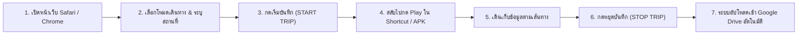
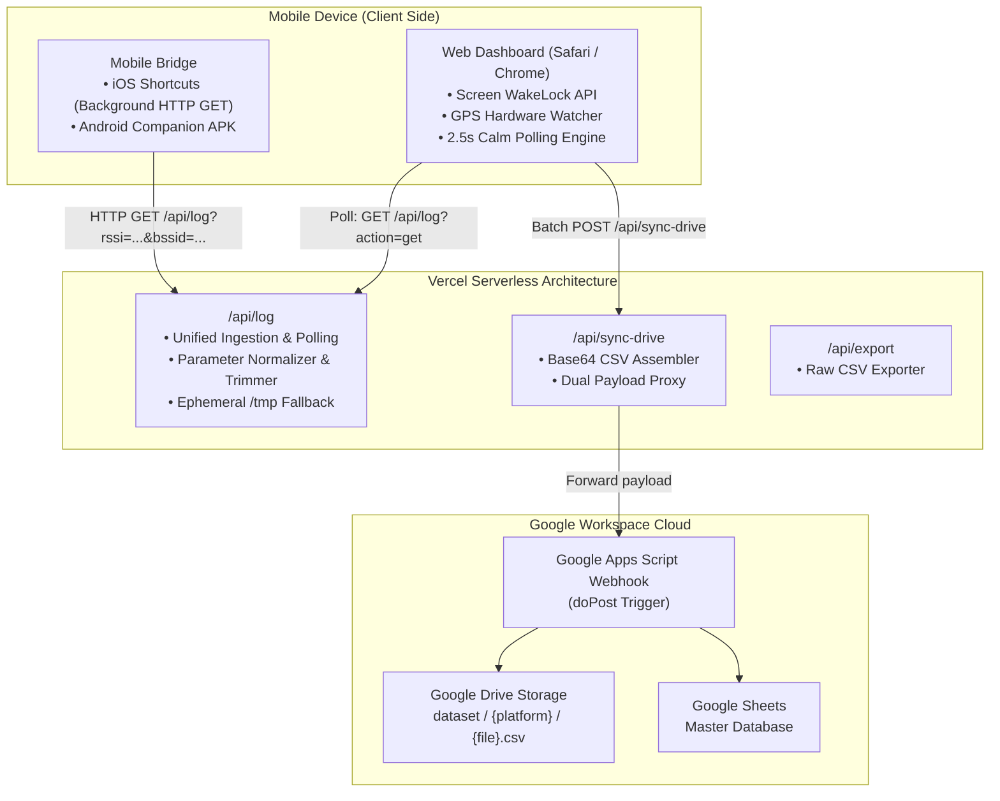

# 📡 RSSI Web Logger: Minimalist Wi-Fi & GPS Telemetry Pipeline

[](https://rssi-web-logger.vercel.app)
[](https://nodejs.org)
[](https://github.com/Kitsada4435/rssi-web-logger)
[](#)
[-success?style=flat)](#)

A production-ready, mobile-first Web Application and Telemetry Bridge pipeline designed for field researchers and university students. Collects synchronized Wi-Fi RSSI (dBm), MAC/BSSID, SSID, and High-Precision GPS metrics directly on **iOS (iOS 17+)** and **Android**, with automated deployment on **Vercel** and seamless cloud synchronization to **Google Drive & Google Sheets**.

---

### 🌐 Language / ภาษา
* [🇹🇭 คู่มือการใช้งานและการพัฒนา (ภาษาไทย)](#คู่มือภาษาไทย-thai-guide)
* [🇬🇧 Developer & Technical Guide (English)](#developer--technical-guide-english)

---

<a name="คู่มือภาษาไทย-thai-guide"></a>
# 🇹🇭 คู่มือภาษาไทย (Thai Guide)

เอกสารฉบับนี้จัดทำขึ้นสำหรับ **นักศึกษาที่เข้าร่วมการทดลองเก็บข้อมูลภาคสนาม** และ **นักพัฒนาที่จะนำระบบนี้ไปต่อยอดในอนาคต**

---

## สารบัญ (Table of Contents)
1. [เกี่ยวกับระบบและจุดเด่น (Overview)](#1-เกี่ยวกับระบบและจุดเด่น)
2. [คู่มือสำหรับนักศึกษา: การติดตั้งและใช้งานบนมือถือ (Student Guide)](#2-คู่มือสำหรับนักศึกษา-การติดตั้งและใช้งานบนมือถือ)
   * [สำหรับ iPhone / iPad (iOS 17+)](#สำหรับ-iphone--ipad-ios-17)
   * [สำหรับสมาร์ตโฟน Android](#สำหรับสมาร์ตโฟน-android)
3. [ขั้นตอนการเก็บข้อมูลภาคสนามจริง (Field Workflow)](#3-ขั้นตอนการเก็บข้อมูลภาคสนามจริง)
4. [การจัดระเบียบข้อมูลบน Google Drive (Drive Organization)](#4-การจัดระเบียบข้อมูลบน-google-drive)
5. [โครงสร้างข้อมูล (Data Schema Specification)](#5-โครงสร้างข้อมูล-data-schema)
6. [คู่มือสำหรับนักพัฒนาต่อยอด (Developer Guide)](#6-คู่มือสำหรับนักพัฒนาต่อยอด)

---

## 1. เกี่ยวกับระบบและจุดเด่น

ระบบ **RSSI Web Logger** พัฒนาขึ้นเพื่อแก้ปัญหาความยุ่งยากในการเก็บข้อมูล Wi-Fi RSSI ภาคสนาม โดยมีจุดเด่นสำคัญ:

* **⚡ ประหยัดเน็ต 100% (Zero Data Drain):** หน้าเว็บถูกตัดแผนที่และกราฟแคนวาสออกทั้งหมด แสดงผลแบบ Text-First ทำให้ไม่เปลืองดาต้ามือถือ และไม่แย่งแบนด์วิดท์กับการยิงพิกัดดาวเทียม
* **🖤 Minimalist OLED Dark UI:** ธีมสีดำสนิท (`#000000`) กรอบบาง สบายตา สไตล์ Apple / Vercel ช่วยประหยัดแบตเตอรี่โทรศัพท์ขณะเดินสำรวจ
* **👤 รหัสเครื่องถาวร (Hardware-Tied Device ID):** ระบบคำนวณรหัสประจำเครื่องจากคุณลักษณะฮาร์ดแวร์โดยอัตโนมัติ (เช่น `IOS-7A2B`) รหัสจะไม่เปลี่ยนเองตลอดไป แม้จะรีเฟรชหน้าเว็บหรือปิดเบราว์เซอร์
* **☁️ ซิงค์เข้า Google Drive อัตโนมัติ:** เมื่อกดปุ่ม "หยุดบันทึก (STOP TRIP)" ระบบจะรวมข้อมูลและอัปโหลดไฟล์ CSV เข้าโฟลเดอร์ Google Drive ของงานวิจัยทันที พร้อมแถบแจ้งเตือนสถานะสดบนหน้าจอ
* **🔋 หน้าจอล็อกไม่ให้ดับ (Screen Wake Lock):** หน้าจอจะสว่างค้างตลอดเวลาที่กำลังบันทึกข้อมูล ป้องกันการหลุดของ GPS

---

## 2. คู่มือสำหรับนักศึกษา: การติดตั้งและใช้งานบนมือถือ

หน้าเว็บ Dashboard ใช้งานได้ทันทีที่: **`https://rssi-web-logger.vercel.app`**

### สำหรับ iPhone / iPad (iOS 17+)

บน iOS ระบบความปลอดภัยของ Apple ไม่อนุญาตให้เว็บเบราว์เซอร์เข้าถึงค่า Wi-Fi BSSID/RSSI โดยตรง จึงต้องใช้ **แอปคำสั่งลัด (Shortcuts)** เป็นสะพานส่งข้อมูลเข้าสู่หน้าเว็บ

#### ขั้นตอนการตั้งค่าสิทธิ์ (ทำครั้งแรกครั้งเดียว)
1. ไปที่ **การตั้งค่า (Settings)** บน iPhone > **ความเป็นส่วนตัวและความปลอดภัย (Privacy & Security)** > **บริการหาตำแหน่งที่ตั้ง (Location Services)**
2. เลื่อนหาแอป **"คำสั่งลัด" (Shortcuts)** > เลือกเป็น **"ในระหว่างใช้แอป" (While Using the App)** *(หากไม่เปิดสิทธิ์นี้ iOS จะบล็อกค่า Wi-Fi ทำให้ได้ค่าว่าง)*

#### ขั้นตอนสร้างคำสั่งลัด (แนะนำ: สร้างเอง 4 บล็อก ใน 30 วินาที)
1. เปิดแอป **"คำสั่งลัด" (Shortcuts)** บน iPhone > กดเครื่องหมาย **`+` (สร้างใหม่)** มุมขวาบน
2. แตะเปลี่ยนชื่อคำสั่งลัดด้านบนเป็น `Send RSSI Web`
3. เพิ่มบล็อกคำสั่งตามลำดับดังนี้:

```text
[ทำซ้ำ 3600 ครั้ง] (Repeat)
  ├── 1. รับ [BSSID] ของเครือข่าย Wi-Fi
  ├── 2. ตั้งค่าตัวแปร [BSSID]
  ├── 3. รับ [ชื่อเครือข่าย] ของเครือข่าย Wi-Fi
  ├── 4. ตั้งค่าตัวแปร [SSID]
  ├── 5. รับ [ความแรงสัญญาณ Wi-Fi] (RSSI) ของเครือข่าย Wi-Fi
  ├── 6. ตั้งค่าตัวแปร [RSSI]
  ├── 7. รับ [ชื่ออุปกรณ์] จากรายละเอียดของอุปกรณ์
  ├── 8. ข้อความ (URL ปลายทาง):
  │      https://rssi-web-logger.vercel.app/api/log?bssid=[BSSID]&ssid=[SSID]&rssi=[RSSI]&participant_id=[ชื่ออุปกรณ์]
  ├── 9. รับเนื้อหาของ URL (จากข้อความด้านบน, วิธีการ: GET)
  └── 10. รอ 1 วินาที (Wait)
[สิ้นสุดทำซ้ำ]
```

> [!IMPORTANT]
> **ข้อควรระวัง 2 ประการที่พบบ่อยที่สุด:**
> 1. **ห้ามเคาะเว้นวรรคหลังเครื่องหมาย `?` เด็ดขาด:** ต้องเขียนติดกันเป็น `.../api/log?bssid=...` หากมีวรรค `? bssid=` ระบบ iOS จะตัดการทำงานทันที
> 2. **ต้องใช้คำสั่ง "รับเนื้อหาของ URL" (ไอคอนสีเขียวลูกศรลง 📥):** ห้ามเลือกคำสั่ง "เปิด URL" (Open URL) เพราะจะทำให้ Safari เด้งเปิดหน้าเว็บรีเฟรชไม่หยุด

#### วิธีปิดการเด้งขออนุญาตซ้ำๆ:
* ในหน้าแก้ไขคำสั่งลัด แตะไอคอน **`(i)`** ด้านล่างสุด > เลือกแท็บ **ความเป็นส่วนตัว (Privacy)** > ตรงการเข้าถึงเว็บเลือก **"อนุญาตเสมอ" (Always Allow)**

---

### สำหรับสมาร์ตโฟน Android

1. เปิดหน้าเว็บ `https://rssi-web-logger.vercel.app` ผ่าน Google Chrome
2. แตะขยายแถบ **"📲 ตัวช่วยส่งสัญญาณ Wi-Fi (iOS / Android)"**
3. กดปุ่ม **"🤖 โหลด Android APK"** เพื่อดาวน์โหลดไฟล์ `rssi-logger-android.apk`
4. ติดตั้งไฟล์ APK ลงในเครื่อง และเปิดสิทธิ์ **Location (ตำแหน่งที่ตั้ง)** และ **Nearby Devices (อุปกรณ์ใกล้เคียง)**

---

## 3. ขั้นตอนการเก็บข้อมูลภาคสนามจริง



1. **เปิดหน้าเว็บ:** เข้า `https://rssi-web-logger.vercel.app`
2. **ตั้งค่าก่อนเริ่มเดินทาง:**
   * **รหัสผู้เข้าร่วม (Device ID):** ระบบคำนวณรหัสเครื่องให้อัตโนมัติ (เช่น `IOS-7A2B`) หรือสามารถพิมพ์รหัสนักศึกษาของตนเองได้
   * **โหมดการเดินทาง:** แตะเลือก 1 โหมด: **เดิน 🚶 / ปั่นจักรยาน 🚲 / มอเตอร์ไซค์ 🛵 / รถยนต์ 🚗**
   * **รายละเอียดสถานที่ / บันทึก (Notes):** *(ไม่บังคับ)* พิมพ์จุดสังเกตเพื่อช่วยจำแนกกลุ่มข้อมูล เช่น `อาคารวิศวะ ชั้น 3, โซนโรงอาหาร`
3. **เริ่มบันทึก:**
   * กดปุ่มใหญ่ **"เริ่มบันทึก (START TRIP)"** (เวลาจะเริ่มเดิน และหน้าจอจะไม่ดับ)
   * สลับไปที่แอปคำสั่งลัด (iOS) แล้วกดปุ่ม **Play (▶ สามเหลี่ยม)** หรือกด **START** ในแอป Companion (Android)
   * สลับกลับมาดูที่หน้าเว็บ ตัวเลข **RSSI (dBm)**, ชื่อ Wi-Fi, MAC Address และพิกัด GPS จะวิ่งอัปเดตสดทุก 1–2 วินาที
4. **สิ้นสุดการเก็บข้อมูล:**
   * เมื่อเดินครบเส้นทาง ให้กดปุ่ม **"หยุดบันทึก (STOP TRIP)"**
   * ระบบจะทำการรวมข้อมูลทั้งหมดของรอบนั้น แล้วส่งขึ้น Google Drive ให้อัตโนมัติ
   * สังเกตแถบแจ้งเตือนบนหน้าจอ:
     * แถบฟ้า: `⏳ กำลังอัปโหลด X จุดเข้า Google Drive...`
     * แถบเขียว: `✅ บันทึกเข้า Google Drive สำเร็จแล้ว (X จุด)`
   * สามารถกดปุ่ม **"โหลด CSV"** เพื่อบันทึกสำเนาลงในเครื่องมือถือได้ทันที

---

## 4. การจัดระเบียบข้อมูลบน Google Drive

ข้อมูลทั้งหมดจะถูกจัดเก็บเข้าสู่โฟลเดอร์ Google Drive ของบัญชีวิจัย:
* **Google Drive Path:** `ไดรฟ์ของฉัน > RSSI_Database > dataset`

### โครงสร้างโฟลเดอร์หลัก:
* 📁 **`dataset/ios/`** — ไฟล์ CSV ข้อมูลจริงที่ถูกส่งมาจากอุปกรณ์ iPhone
* 📁 **`dataset/android/`** — ไฟล์ CSV ข้อมูลจริงจากอุปกรณ์ Android
* 📁 **`dataset/web/`** — ไฟล์ CSV จากการทดสอบผ่านเบราว์เซอร์คอมพิวเตอร์
* 🗑️ **`0.0` (โฟลเดอร์ขยะ):** หากพบโฟลเดอร์ชื่อนี้ สามารถ**กดลบทิ้งได้ทันที** (เกิดจากการทดสอบส่งค่าในเวอร์ชันเริ่มต้น)

---

## 5. โครงสร้างข้อมูล (Data Schema)

ไฟล์ CSV ทุกไฟล์ที่ดาวน์โหลดจากระบบ หรือถูกอัปโหลดขึ้น Google Drive จะมีโครงสร้างคอลัมน์มาตรฐาน 12 คอลัมน์ดังนี้:

| ลำดับ | ชื่อคอลัมน์ (Column) | ประเภทข้อมูล | ตัวอย่างข้อมูล | คำอธิบาย |
| :---: | :--- | :---: | :--- | :--- |
| 1 | `timestamp` | ISO 8601 String | `2026-11-02T12:47:29.387Z` | วันและเวลาที่บันทึกข้อมูลพิกัดระดับมิลลิวินาที |
| 2 | `participant_id` | String | `IOS-7A2B` หรือ `iPhone-Kitsada` | รหัสฮาร์ดแวร์ประจำเครื่อง หรือชื่ออุปกรณ์ |
| 3 | `trip_id` | String | `TRIP-20261102-A9F2` | รหัสรอบการเดินทางที่ไม่ซ้ำกันในแต่ละครั้ง |
| 4 | `latitude` | Float | `13.75633` | ละติจูดพิกัดดาวเทียม GPS จากเบราว์เซอร์ |
| 5 | `longitude` | Float | `100.50185` | ลองจิจูดพิกัดดาวเทียม GPS จากเบราว์เซอร์ |
| 6 | `accuracy` | Float (เมตร) | `4.0` | รัศมีความคลาดเคลื่อนของ GPS (ยิ่งน้อยยิ่งแม่นยำ) |
| 7 | `speed` | Float (km/h) | `1.4` | ความเร็วในการเคลื่อนที่ขณะบันทึกจุดนั้นๆ |
| 8 | `ssid` | String | `Faculty-WiFi_5G` | ชื่อเครือข่าย Wi-Fi ที่อุปกรณ์เชื่อมต่ออยู่ |
| 9 | `bssid` | String | `00:1A:2B:3C:4D:5E` | MAC Address ของ Access Point ตัวที่จับสัญญาณ |
| 10 | `rssi` | Integer (dBm) | `-58` | ค่าความแรงสัญญาณ Wi-Fi (ระดับ -30 ถึง -99 dBm) |
| 11 | `user_label_mode` | String | `walk`, `bike`, `moto`, `car` | โหมดการเดินทางที่ผู้ใช้กดเลือก |
| 12 | `note` | String | `อาคารวิศวะ ชั้น 3, โซนแล็บ` | รายละเอียดสถานที่หรือจุดสังเกตเพิ่มเติม |

---

## 6. คู่มือสำหรับนักพัฒนาต่อยอด

### การทำงานร่วมกันระหว่าง Serverless และเบราว์เซอร์
บนแพลตฟอร์ม Vercel สถาปัตยกรรมทำงานเป็น Serverless Functions โดยมีข้อกำหนดว่า **แต่ละฟังก์ชันทำงานแบบไร้สถานะ (Stateless)** ดังนั้น:
* ไฟล์ [`api/log.js`](file:///c:/Users/USER/Desktop/RSSI%20Web%20Logger/api/log.js) จึงทำหน้าที่เป็น **Unified Endpoint**:
  * เมื่อ Shortcut หรือ Mobile APK ส่งข้อมูล: จะเรียก `GET /api/log?rssi=...` เพื่อบันทึกข้อมูล
  * เมื่อหน้าเว็บ Dashboard ดึงข้อมูล: จะเรียก `GET /api/log?action=get` เพื่ออ่านข้อมูลจาก In-Memory Store และไฟล์แคชชั่วคราว `/tmp/rssi_store.json`
* ระบบหน้าเว็บเปลี่ยนจากการใช้ Server-Sent Events (SSE) มาเป็น **Calm Polling (2.5 วินาที)** ผ่าน [`public/app.js`](file:///c:/Users/USER/Desktop/RSSI%20Web%20Logger/public/app.js) เพื่อป้องกันไม่ให้เบราว์เซอร์ Safari ขึ้นแถบโหลดรีเฟรชรัวๆ

### การทดสอบรันบนเครื่อง Localhost:
```bash
# 1. ติดตั้ง Dependencies
npm install

# 2. เริ่มต้นรันเซิร์ฟเวอร์ Express ภายในเครื่อง
npm start

# 3. เปิดเบราว์เซอร์ที่
http://localhost:3000
```

---

<br><br>

---

<a name="developer--technical-guide-english"></a>
# 🇬🇧 Developer & Technical Guide (English)

This section contains technical documentation for developers maintaining, extending, or deploying the **RSSI Web Logger** infrastructure.

---

## Architecture Specification



---

## API Reference

### 1. Ingest / Query Telemetry: `/api/log`
Supports both recording telemetry from mobile devices and polling latest records to the web client.

* **Method:** `GET` | `POST`
* **Query Parameters (Ingestion):**
  * `bssid` (string): BSSID / MAC Address of the Access Point.
  * `ssid` (string): SSID of the connected Wi-Fi network.
  * `rssi` (integer): Signal strength in dBm (e.g. `-65`).
  * `participant_id` (string): Unique device fingerprint or participant name.
  * `trip_id` (string, optional): Current trip identifier.
  * `note` (string, optional): Location description or research note.
* **Query Parameters (Dashboard Polling):**
  * `action=get`: Fetches all in-memory telemetry entries since the container started.
* **Query Parameters (Data Reset):**
  * `action=clear` or `DELETE /api/log`: Flushes in-memory and temporary storage.

#### Sample Ingestion Request:
```http
GET /api/log?bssid=00:1A:2B:3C:4D:5E&ssid=Campus-WiFi&rssi=-58&participant_id=IOS-7A2B HTTP/1.1
Host: rssi-web-logger.vercel.app
```

#### Sample Response:
```json
{
  "status": "ok",
  "count": 42,
  "entry": {
    "id": 42,
    "timestamp": "2026-11-02T12:47:29.387Z",
    "participant_id": "IOS-7A2B",
    "trip_id": "TRIP-20261102-A9F2",
    "bssid": "00:1A:2B:3C:4D:5E",
    "ssid": "Campus-WiFi",
    "rssi": -58,
    "latitude": 13.75633,
    "longitude": 100.50185,
    "speed": 1.4,
    "accuracy": 4.0,
    "user_label_mode": "walk",
    "note": "Engineering Building Floor 3"
  }
}
```

---

### 2. Batch Cloud Sync: `/api/sync-drive`
Triggered automatically when the user taps **"STOP TRIP"** or manually clicks **"ซิงค์เข้า Drive"**.

* **Method:** `POST`
* **Headers:** `Content-Type: application/json`
* **Body:**
```json
{
  "webhook_url": "https://script.google.com/macros/s/.../exec",
  "trip_id": "TRIP-20261102-A9F2",
  "participant_id": "IOS-7A2B",
  "logs": [ ...array of telemetry entries... ]
}
```

---

## Project Structure

```text
RSSI Web Logger/
├── README.md                            # Comprehensive Bilingual Documentation
├── package.json                         # Node.js dependencies & npm scripts
├── server.js                            # Local development Express server + proxy
├── vercel.json                          # Vercel Serverless rewrite configurations
├── Send Rssi Logger web.shortcut        # Pre-configured iOS Shortcut template
├── api/                                 # Vercel Serverless Functions
│   ├── log.js                           # Unified telemetry ingestion & polling
│   ├── sync-drive.js                    # Batch Google Drive / Sheets sync proxy
│   ├── logs.js                          # Backward-compatibility alias
│   └── export.js                        # CSV generation and download stream
├── public/                              # Mobile Web Dashboard Assets
│   ├── index.html                       # Minimalist OLED Dark UI markup
│   ├── style.css                        # Zero-overflow CSS design system
│   ├── app.js                           # State controller, GPS tracker, and polling
│   └── downloads/                       # Direct client download bundles
│       ├── Send Rssi Logger web.shortcut
│       ├── rssi-logger-android.apk
│       └── macrodroid_guide.txt
└── scripts/
    ├── google_drive_script.js           # Google Apps Script code for Google Drive
    └── test_ping.py                     # Python telemetry simulation utility
```

---

## Deployment & CI/CD

This repository is integrated with Vercel for continuous deployment:
1. Every commit pushed to the `main` branch automatically triggers a production build on Vercel.
2. The serverless functions are configured with strict rewrite rules in `vercel.json` ensuring clean URLs without displaying `.js` file extensions.
3. No external database configuration is required; the application utilizes ephemeral in-memory storage during field trips and persists directly to the research Google Drive upon trip conclusion.

---

## License & Credits

* **Project:** Field Wi-Fi RSSI & Telemetry Data Collector
* **Organization:** Research Data Collection Pipeline
* **License:** [MIT License](LICENSE)
