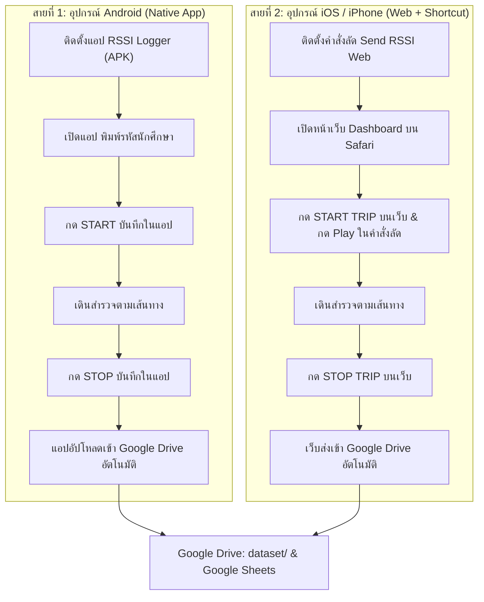
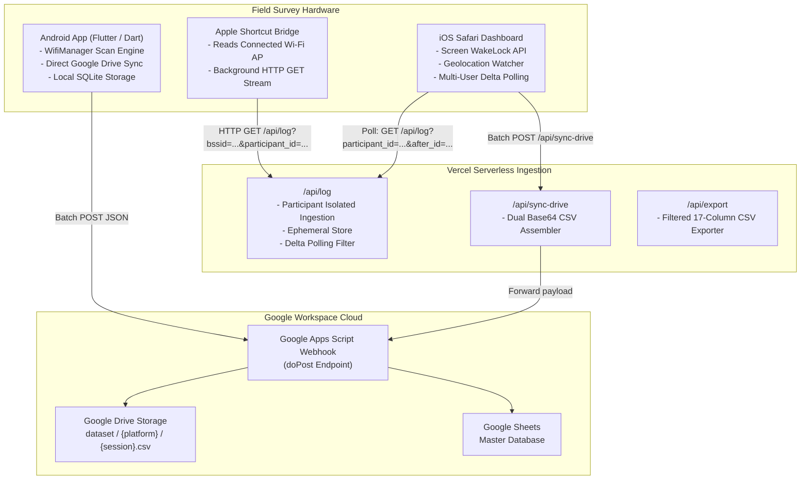

# Wi-Fi and GPS Telemetry Pipeline for Indoor Localization Research

[](https://rssi-web-logger.vercel.app)
[](https://nodejs.org)
[](https://github.com/Kitsada4435/rssi-web-logger)
[](#)

Unified Telemetry Architecture for indoor and outdoor wireless signal mapping, mobility tracking, and Wi-Fi fingerprinting research. Combines a standalone Android Application (Flutter) and an iOS Web Dashboard Pipeline (Apple Shortcuts + Vercel Serverless) into a single monorepo.

---

### Language / ภาษา
* [คู่มือภาษาไทย (Thai Guide)](#คู่มือภาษาไทย-thai-guide)
* [Developer and Technical Guide (English)](#developer-and-technical-guide-english)

---

<a name="คู่มือภาษาไทย-thai-guide"></a>
# คู่มือภาษาไทย (Thai Guide)

เอกสารฉบับนี้จัดทำขึ้นสำหรับนักศึกษาผู้ร่วมเก็บข้อมูลภาคสนาม และนักวิจัยที่พัฒนาระบบต่อยอด

---

## สารบัญ
1. [โครงสร้างสถาปัตยกรรมและการแบ่งสายอุปกรณ์](#1-โครงสร้างสถาปัตยกรรมและการแบ่งสายอุปกรณ์)
2. [แนวทางปฏิบัติภาคสนามสำหรับนักศึกษา (Field Protocol)](#2-แนวทางปฏิบัติภาคสนามสำหรับนักศึกษา-field-protocol)
   * [สายที่ 1: สำหรับสมาร์ตโฟน Android (ใช้งานผ่านแอปพลิเคชันเดี่ยว จบในตัว)](#สายที่-1-สำหรับสมาร์ตโฟน-android)
   * [สายที่ 2: สำหรับ iPhone / iPad (ใช้งานผ่านเว็บ Safari และคำสั่งลัด)](#สายที่-2-สำหรับ-iphone--ipad-ios-17)
3. [โครงสร้างข้อมูลมาตรฐานวิจัย 17 คอลัมน์ (Data Schema)](#3-โครงสร้างข้อมูลมาตรฐานวิจัย-17-คอลัมน์-data-schema)
4. [การจัดเก็บข้อมูลบน Google Drive และ Google Sheets](#4-การจัดเก็บข้อมูลบน-google-drive-และ-google-sheets)
5. [การจัดการความซ้ำซ้อนของ Repository](#5-การจัดการความซ้ำซ้อนของ-repository)

---

## 1. โครงสร้างสถาปัตยกรรมและการแบ่งสายอุปกรณ์

เนื่องจากข้อกำหนดความปลอดภัยของระบบปฏิบัติการมือถือ (Mobile OS Sandbox) มีความแตกต่างกันอย่างสิ้นเชิง ระบบจึงถูกออกแบบให้แยกกระบวนการทำงานออกเป็น 2 สายที่เหมาะสมกับฮาร์ดแวร์ที่สุด โดยที่ผู้ใช้ไม่ต้องสลับหน้าจอไปมา:



---

## 2. แนวทางปฏิบัติภาคสนามสำหรับนักศึกษา (Field Protocol)

<a name="สายที่-1-สำหรับสมาร์ตโฟน-android"></a>
### สายที่ 1: สำหรับสมาร์ตโฟน Android (ใช้งานผ่านแอปพลิเคชันเดี่ยว จบในตัว)

ผู้ใช้ Android ไม่จำเป็นต้องเปิดเว็บเบราว์เซอร์ ให้ใช้งานผ่านแอปพลิเคชันตัวเดียวจบ 100%:

#### ขั้นตอนการติดตั้ง (ทำครั้งแรกครั้งเดียว)
1. ดาวน์โหลดไฟล์ `rssi-logger-android.apk` จากหน้าเว็บ `https://rssi-web-logger.vercel.app` หรือจากโฟลเดอร์โครงการ
2. แตะติดตั้งไฟล์ APK ลงในโทรศัพท์
3. ไปที่ **การตั้งค่า (Settings)** ของมือถือ > **แอป (Apps)** > **RSSI Logger** > **สิทธิ์ (Permissions)**:
   * **ตำแหน่งที่ตั้ง (Location):** กำหนดเป็น **อนุญาตตลอดเวลา (Allow all the time)**
   * **อุปกรณ์ใกล้เคียง (Nearby devices):** กำหนดเป็น **อนุญาต (Allow)**

#### ขั้นตอนการเก็บข้อมูลจริง
1. เลื่อนแถบแจ้งเตือนด้านบนลงมา แล้วแตะเปิด **ตำแหน่ง (Location / GPS)** ของโทรศัพท์
2. เปิดแอป **RSSI Logger**
3. ระบุข้อมูลก่อนเริ่มเดิน:
   * **Participant ID:** พิมพ์รหัสนักศึกษา (เช่น `680631034`)
   * **Mode:** เลือกโหมดเดินทาง (เดิน / ปั่นจักรยาน / มอเตอร์ไซค์ / รถยนต์)
   * **Position:** เลือกลักษณะการพกพา (กางเกง / ในมือ / กระเป๋า)
4. แตะปุ่ม **START TRIP**
5. เดินเก็บข้อมูลตามเส้นทางที่กำหนด
6. เมื่อสิ้นสุดเส้นทาง แตะปุ่ม **STOP TRIP**
7. ข้อมูลจะถูกบันทึกลงในเครื่อง และส่งขึ้นสู่ Google Drive ของโครงการโดยอัตโนมัติ

---

<a name="สายที่-2-สำหรับ-iphone--ipad-ios-17"></a>
### สายที่ 2: สำหรับ iPhone / iPad (iOS 17+)

บน iOS เบราว์เซอร์ถูก Apple ป้องกันไม่ให้อ่านค่า Wi-Fi จึงต้องใช้คำสั่งลัดคู่กับหน้าเว็บ:

#### ขั้นตอนการติดตั้ง (ทำครั้งแรกครั้งเดียว)
1. ไปที่ **การตั้งค่า (Settings)** บน iPhone > **ความเป็นส่วนตัวและความปลอดภัย (Privacy & Security)** > **บริการหาตำแหน่งที่ตั้ง (Location Services)**
2. เลื่อนหาแอป **คำสั่งลัด (Shortcuts)** > เลือกเป็น **ในระหว่างใช้แอป (While Using the App)**
3. เปิดหน้าเว็บ `https://rssi-web-logger.vercel.app` บน Safari แตะขยายแถบเครื่องมือช่วย แล้วดาวน์โหลดไฟล์ `Send Rssi Logger Web.shortcut` จากนั้นแชร์เข้าสู่แอปคำสั่งลัด

#### ขั้นตอนการเก็บข้อมูลจริง
1. เปิดหน้าเว็บ `https://rssi-web-logger.vercel.app` บน Safari
2. ระบุข้อมูลก่อนเริ่มเดินทาง:
   * **รหัสผู้เข้าร่วม (Device ID):** พิมพ์รหัสนักศึกษา (เช่น `680631031`)
   * **โหมดการเดินทาง:** แตะเลือกโหมด (เดิน / จักรยาน / มอเตอร์ไซค์ / รถ)
   * **ตำแหน่งพกพา:** แตะเลือก (กางเกง / ในมือ / กระเป๋า)
3. แตะปุ่ม **เริ่มบันทึก (START TRIP)** บนหน้าเว็บ
4. สลับไปแตะปุ่ม **Play** ในแอปคำสั่งลัด (หรือกดจากวิดเจ็ตหน้าจอโฮม)
5. สลับกลับมาดูหน้าเว็บ จะเห็นค่า Wi-Fi RSSI และพิกัด GPS อัปเดตสดทุก 1-2 วินาที
6. เดินสำรวจตามเส้นทาง
7. เมื่อสิ้นสุดเส้นทาง แตะปุ่ม **หยุดบันทึก (STOP TRIP)** บนหน้าเว็บ
8. ระบบจะส่งข้อมูลทั้งหมดขึ้น Google Drive ของโครงการวิจัยโดยอัตโนมัติ

---

## 3. โครงสร้างข้อมูลมาตรฐานวิจัย 17 คอลัมน์ (Data Schema)

ไฟล์ CSV ทุกไฟล์จากทั้ง Android และ iOS ถูกจัดเก็บในรูปแบบตารางมาตรฐานเดียวกัน 17 คอลัมน์หลัก:

| ลำดับ | ชื่อคอลัมน์ (Column) | ประเภทข้อมูล | ตัวอย่างข้อมูล | คำอธิบาย |
| :---: | :--- | :---: | :--- | :--- |
| 1 | `t_utc_ms` | Integer (Epoch ms) | `1793766101811` | เวลา Unix Epoch มิลลิวินาทีสำหรับซิงค์ข้อมูลข้ามอุปกรณ์ |
| 2 | `timestamp` | ISO 8601 String | `2026-11-04T11:21:41.811Z` | วันและเวลามาตรฐานสากล UTC |
| 3 | `session_id` | String | `TRIP-20261104-A9F2` | รหัสรอบการเก็บข้อมูล (Trip / Session ID) |
| 4 | `participant_id` | String | `680631034` หรือ `IOS-7A2B` | รหัสนักศึกษาหรือรหัสฮาร์ดแวร์ประจำเครื่อง |
| 5 | `platform` | String | `android`, `ios`, `web` | ระบบปฏิบัติการของอุปกรณ์ |
| 6 | `device_model` | String | `samsung SM-S948B`, `iPhone` | รุ่นของอุปกรณ์โทรศัพท์ |
| 7 | `lat` | Float | `18.7954698` | ละติจูดพิกัดดาวเทียม GPS |
| 8 | `lon` | Float | `98.9528959` | ลองจิจูดพิกัดดาวเทียม GPS |
| 9 | `speed` | Float | `1.4` (km/h หรือ m/s) | ความเร็วในการเคลื่อนที่ |
| 10 | `accuracy` | Float (เมตร) | `5.0` | รัศมีความคลาดเคลื่อนของ GPS (ยิ่งน้อยยิ่งแม่นยำ) |
| 11 | `bssid` | String | `04:5f:b9:e4:f1:4a` | MAC Address ของ Wi-Fi Access Point |
| 12 | `ssid` | String | `@JumboPlus5GHz` | ชื่อเครือข่าย Wi-Fi |
| 13 | `rssi_raw` | Float (dBm) | `-45.0` | ค่าความแรงสัญญาณดิบ Wi-Fi RSSI |
| 14 | `user_label_mode` | String | `walk`, `bike`, `motorcycle`, `car` | โหมดการเดินทางที่ผู้สำรวจเลือกด้วยตนเอง |
| 15 | `activity_recognition_mode` | String | `still`, `walk`, `run`, `vehicle` | โหมดการเคลื่อนไหวที่ระบบตรวจจับอัตโนมัติ |
| 16 | `phone_position` | String | `pocket`, `hand`, `bag` | ลักษณะการพกพาโทรศัพท์ขณะเก็บข้อมูล |
| 17 | `note` | String | `อาคารวิศวะ ชั้น 3, โซนแล็บ` | บันทึกช่วยจำสถานที่หรือจุดสังเกตเพิ่มเติม |

---

## 4. การจัดเก็บข้อมูลบน Google Drive และ Google Sheets

ข้อมูลโทรมาตรทั้งหมดจะถูกรวบรวมเข้าสู่ Google Drive ของโครงการวิจัย:
* **Google Drive Path:** `ไดรฟ์ของฉัน > RSSI_Database > dataset`
* `dataset/android/` — ไฟล์ CSV จากแอปพลิเคชัน Android
* `dataset/ios/` — ไฟล์ CSV จากหน้าเว็บ Safari บน iPhone
* **Google Sheet กลาง:** บันทึกข้อมูลเรียงตามแถวพร้อมระบุรหัสนักศึกษาและรหัสรอบการเดินทาง

---

## 5. การจัดการความซ้ำซ้อนของ Repository

เดิมทีโครงการมี 2 Repository แยกกันบน GitHub คือ `rssi_logger_app` (แอป Flutter เก่า) และ `rssi-web-logger` (หน้าเว็บ Vercel) ทำให้เกิดความซ้ำซ้อน

### แนวทางการรวมเป็น Repository เดียว (Monorepo)
ปัจจุบันโครงการนี้ได้รวมทั้ง Website และ Mobile App เข้าด้วยกันในโฟลเดอร์เดียวเรียบร้อยแล้ว:

#### คำแนะนำในการจัดการ GitHub
1. **เปลี่ยนชื่อ Repository หลัก:**
   * ไปที่ GitHub Repository `https://github.com/Kitsada4435/rssi-web-logger`
   * เข้าแท็บ **Settings** > ส่วน **Repository name**
   * เปลี่ยนชื่อเป็น `wifi-telemetry-pipeline` หรือชื่อที่ต้องการ
2. **เก็บถาวร (Archive) Repo เก่า:**
   * ไปที่ GitHub Repository `https://github.com/Kitsada4435/rssi_logger_app`
   * เข้าแท็บ **Settings** > เลื่อนลงล่างสุดในส่วน **Danger Zone**
   * เลือก **Archive this repository** เพื่อป้องกันความสับสน

---

<br><br>

---

<a name="developer-and-technical-guide-english"></a>
# Developer and Technical Guide (English)

Technical documentation for researchers and software engineers extending or maintaining the **Wi-Fi and GPS Telemetry Pipeline**.

---

## Architecture Specification



---

## Monorepo Directory Layout

```text
wifi-telemetry-pipeline/
├── README.md                            # Comprehensive Bilingual Documentation
├── package.json                         # Node.js dependencies and project metadata
├── server.js                            # Local development Express server
├── vercel.json                          # Vercel Serverless rewrite configurations
├── api/                                 # Vercel Serverless Functions (Website API)
│   ├── log.js                           # Telemetry ingestion and multi-user delta polling
│   ├── sync-drive.js                    # Batch Google Drive / Sheets sync proxy
│   ├── logs.js                          # Backward-compatibility alias
│   └── export.js                        # Isolated 17-column CSV export stream
├── public/                              # Web Dashboard Frontend Assets (iOS / Desktop)
│   ├── index.html                       # Minimalist high-contrast user interface
│   ├── style.css                        # Mobile-optimized dark mode CSS
│   ├── app.js                           # State controller, GPS watcher, delta polling
│   └── downloads/                       # Direct client distribution bundles
│       ├── Send Rssi Logger Web.shortcut # Pre-configured iOS Shortcut template
│       ├── rssi-logger-android.apk      # Standalone Android Logger APK
│       └── macrodroid_guide.txt         # Alternative Android MacroDroid instructions
├── mobile_app/                          # Standalone Android Application (Flutter)
│   ├── android/                         # Native Android Gradle project configuration
│   ├── ios/                             # Native iOS runner configuration
│   ├── lib/                             # Dart application source code
│   │   ├── main.dart                    # Application UI entry point
│   │   ├── sensor_manager.dart          # Wi-Fi BSSID/RSSI, GPS, and motion manager
│   │   ├── cloud_manager.dart           # Direct Google Apps Script upload engine
│   │   └── export_manager.dart          # Local SQLite and CSV export engine
│   └── pubspec.yaml                     # Flutter package dependencies
├── docs/                                # Academic Papers, Research Proposals & Specs
│   ├── Phase_0_Research_Proposal_And_Specs.md
│   ├── Phase_1_App_Development_And_Pipeline.md
│   ├── Phase_2_Data_Collection_And_ML_Pipeline.md
│   ├── RESEARCH_TITLES_AND_CONCEPTS.md
│   └── 4Inferring_Trips_and_Origin-Destination_Flows_...pdf
├── dataset/                             # Field Survey CSV Verification Datasets
└── scripts/
    ├── google_drive_script.js           # Production Google Apps Script webhook code
    └── test_ping.py                     # CLI telemetry ingestion simulation script
```

---

## API Reference

### 1. Ingest and Poll Telemetry: `/api/log`
Ingests telemetry packets from mobile clients and delivers isolated streams to matching web clients.

* **Method:** `GET` | `POST`
* **Query Parameters (Ingestion):**
  * `bssid` (string): MAC Address / BSSID of the Access Point.
  * `ssid` (string): Wi-Fi network SSID.
  * `rssi` / `rssi_raw` (number): Received signal strength indicator in dBm.
  * `participant_id` (string, required): Hardware identifier or Student ID.
  * `session_id` / `trip_id` (string, optional): Current trip identifier.
  * `lat` / `latitude` (float, optional): Latitude coordinate.
  * `lon` / `longitude` (float, optional): Longitude coordinate.
  * `speed` (float, optional): Moving speed.
  * `accuracy` (float, optional): Horizontal accuracy in meters.
  * `user_label_mode` (string, optional): Ground-truth mode (`walk`, `bike`, `motorcycle`, `car`).
  * `activity_recognition_mode` (string, optional): Motion recognition mode (`still`, `walk`, `run`, `vehicle`).
  * `phone_position` (string, optional): Carrying position (`pocket`, `hand`, `bag`).
  * `note` (string, optional): Contextual location description.
* **Query Parameters (Multi-User Dashboard Polling):**
  * `action=get`: Required for polling telemetry.
  * `participant_id` (string, required): Only returns records matching this participant ID.
  * `after_id` (integer, optional): Only returns records with `id > after_id` for efficient delta polling.
* **Query Parameters (Data Reset):**
  * `action=clear&participant_id=...` or `DELETE`: Flushes in-memory storage for that specific participant only.

#### Sample Ingestion Request:
```http
GET /api/log?bssid=04:5F:B9:E4:F1:4A&ssid=@JumboPlus5GHz&rssi=-45&participant_id=680631034&user_label_mode=walk&phone_position=pocket HTTP/1.1
Host: rssi-web-logger.vercel.app
```

#### Sample Polling Request:
```http
GET /api/log?action=get&participant_id=680631034&after_id=42 HTTP/1.1
Host: rssi-web-logger.vercel.app
```

---

### 2. Batch Cloud Sync: `/api/sync-drive`
Proxies survey batch datasets to Google Apps Script.

* **Method:** `POST`
* **Headers:** `Content-Type: application/json`
* **Body:**
```json
{
  "webhook_url": "https://script.google.com/macros/s/.../exec",
  "trip_id": "TRIP-20261104-A9F2",
  "participant_id": "680631034",
  "logs": [ ...array of 17-column telemetry entries... ]
}
```

---

## Local Development and Deployment

### 1. Running the Web Pipeline Locally
```bash
# Install dependencies
npm install

# Start local server
npm start

# Access local dashboard
http://localhost:3000
```

### 2. Building the Android Mobile Application
```bash
cd mobile_app
flutter pub get
flutter build apk --release
# Output: mobile_app/build/app/outputs/flutter-apk/app-release.apk
```

### 3. Vercel Deployment
Every push to the `main` branch automatically deploys to Vercel production. Serverless rewrites in `vercel.json` manage API routing.

---

## License

* **Project:** Wi-Fi and GPS Telemetry Pipeline for Indoor Localization Research
* **License:** [MIT License](LICENSE)
