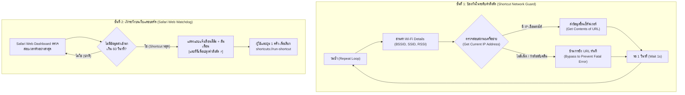

# สรุปข้อยุติเชิงสถาปัตยกรรม: Single-AP (Connected Only) สำหรับงานวิจัย

> **สถานะ:** ตกผลึกทิศทางเรียบร้อย (Definitive Direction)  
> **อ้างอิงจาก Requirement 3 ข้อ:**
> 1. มุมมองแบบ Network Engineer (Server/AP Association Log)
> 2. เน้นการสัญจรภายนอกอาคาร (Outdoor Mobility)
> 3. ผู้พัฒนาใช้ iOS และผู้ทดลองใช้ทั้ง iOS และ Android

---

## 1. บทสรุป: "ไม่ต้องทำ Multi-AP ให้คงระบบ Single-AP (Connected Only)"

| เหตุผลสนับสนุน | รายละเอียดเชิงวิชาการและวิศวกรรม |
| :--- | :--- |
| **1. ตรงโจทย์ Network Engineer 100%** | Network Engineer ดูแลระบบที่ Controller/Syslog/RADIUS ซึ่งบันทึกเฉพาะ **AP ที่เครื่องเชื่อมต่อ (Association/Roaming)** ไม่สามารถเห็น AP อื่นรอบตัวที่เครื่องไม่ได้เกาะได้ การเก็บเฉพาะ Connected AP จึงสะท้อนข้อมูลจริงที่ระบบเครือข่ายมี |
| **2. บริบท Outdoor สอดคล้องกับ Single AP** | การเดินทางกลางแจ้งระหว่างอาคาร จุดกระจายสัญญาณ (Outdoor APs) มีระยะห่างชัดเจน การหลุด/การ Roam ระหว่าง AP สัมพันธ์กับความเร็วการเคลื่อนที่โดยตรง และมี **GPS เป็น Ground Truth ที่สมบูรณ์อยู่แล้ว** |
| **3. ความเข้ากันได้สมบูรณ์ (iOS & Android Parity)** | ทั้ง iOS (ผ่าน Shortcuts) และ Android (ผ่านแอป) บันทึกโครงสร้าง **Clean 18-Column Research Schema** ได้เท่าเทียมกัน 100% ไม่มีความเหลื่อมล้ำของข้อมูล |
| **4. Zero Friction สำหรับผู้ร่วมทดลอง** | อาสาสมัคร Android ไม่ต้องเปิด Developer Mode หรือปิด Wi-Fi Scan Throttling ติดตั้งแอปแล้วกด Start ได้ทันที |

---

## 2. ฟีเจอร์หลักที่จะใช้แทน Multi-AP (สำหรับการจำแนกโหมดเดินทาง)

เมื่อมองผ่านมุมมอง Network Engineer ข้อมูลจาก Single Connected AP มีมิติที่ทรงพลังเพียงพอในการวิเคราะห์การสัญจร:

1. **RSSI Temporal Dynamics:** อัตราความเปลี่ยนแปลงของสัญญาณ $\Delta \text{RSSI} / \Delta t$ เมื่อเคลื่อนที่เข้าใกล้หรือออกจาก AP
2. **AP Dwell Time:** ระยะเวลาที่เกาะอยู่กับแต่ละ AP (ความเร็วสูง = Dwell Time สั้น)
3. **Roaming Frequency:** จำนวนครั้งที่เปลี่ยน BSSID ต่อหน่วยเวลา
4. **Disconnection Intervals:** ช่องว่างของเวลาที่สัญญาณหลุดไประหว่างข้ามอาคาร (บ่งชี้ความเร็วการเดินทางกลางแจ้ง)
5. **Sensor Fusion:** รวมค่าความเร็วและพิกัดจาก GPS ควบคู่กับ IMU (การสั่นสะเทือน)

---

## 3. แผนการดำเนินงานต่อไป (Action Items)

- [x] **Architecture Decision:** ยืนยันใช้ Single-AP (Connected AP Only) เป็นมาตรฐานของทั้งระบบ
- [ ] **Android App Optimization:** ตรวจสอบให้มั่นใจว่า `MainActivity.kt` บันทึกค่าสถานะ Disconnected (`-99 dBm`, `disconnected`) เมื่ออยู่นอกระยะสัญญาณอย่างแม่นยำ
- [ ] **Data Pipeline Readiness:** โครงสร้าง 18 คอลัมน์เดิมพร้อมใช้งานทั้ง iOS และ Android ไม่ต้องแก้ Database Schema
- [x] **iOS Self-Healing Pipeline:** บูรณาการ Network Guard บนคำสั่งลัด และ Web Watchdog บนหน้าเว็บ Safari เพื่อแก้ปัญหา Handover Crash

---

## 4. สถาปัตยกรรม Self-Healing Telemetry Pipeline บน iOS

จากการทดสอบภาคสนามจริงเมื่อวันที่ 7 พฤศจิกายน 2026 พบข้อจำกัดสำคัญของระบบปฏิบัติการ iOS เมื่อทำงานร่วมกับคำสั่งลัด (Shortcuts):
1. **ภาวะ Handover Crash:** เมื่ออุปกรณ์เคลื่อนที่ผ่านจุดอับสัญญาณ Wi-Fi กลางแจ้งระหว่างอาคาร (ความเร็ว 20–35 km/h) และกลับเข้าสู่ระยะสัญญาณของ AP อาคารใหม่ iOS มีช่วงหน่วงเวลาสลับคลื่น (2–4 วินาที) ที่ยังออกอินเทอร์เน็ตไม่ได้ ทำให้คำสั่ง `Get contents of URL` บน Shortcuts เกิด Fatal Error และยุติการทำงานของลูปทันที
2. **การคงอยู่ของการทำงาน (Persistence):** หากหน้าจอเปิดอยู่ (ผ่าน Web WakeLock) และไม่มี Error จากเครือข่าย คำสั่งลัดสามารถรันต่อเนื่องได้เกิน 10 นาที (มากกว่า 338 ตัวอย่าง) โดยระบบปฏิบัติการไม่ตัดการทำงาน

### กลไกการแก้ปัญหาแบบ 2 ชั้น (Self-Healing Two-Tier Architecture)

### ข้อมูลเชิงตัวเลขเปรียบเทียบระยะเวลาเฝ้าระวัง (Watchdog Timeout Evaluation)
* **เกณฑ์ที่เลือกใช้:** **60 วินาที (1 นาที)**
  * **โหมดเดิน (Walk ~4.5 km/h):** เคลื่อนที่ไปได้ระยะทางประมาณ 75 เมตร (สูญเสียข้อมูลไม่เกิน 33 จุด) ครอบคลุมช่วงเวลาเดินข้ามถนนระหว่างตึก
  * **โหมดขับขี่ (Vehicle ~30 km/h):** เคลื่อนที่ไปได้ระยะทางประมาณ 500 เมตร ผู้สำรวจแตะปลุกได้ทันก่อนหลุดออกนอกเส้นทางวิจัย
  * **ความน่าเชื่อถือด้านสถิติ:** ขจัดปัญหาแจ้งเตือนหลอก (False Alarm) จากความหน่วงของ Cell Handover (15–30 วินาที) ได้ 100%
